\# DeployFlow — Production Engineering Blueprint


> A self-service application deployment and management platform built with Laravel.


\*\*Project type:\*\* Developer Platform / Platform Engineering  

\*\*Architecture:\*\* Modular Monolith + Isolated Execution Workers  

\*\*Backend:\*\* Laravel 13  

\*\*Frontend:\*\* Inertia.js + React + TypeScript  

\*\*Database:\*\* PostgreSQL  

\*\*Queue \& Cache:\*\* Redis  

\*\*Containerization:\*\* Docker / BuildKit  

\*\*Source Integration:\*\* GitHub App  

\*\*CI/CD:\*\* GitHub Actions  

\*\*License:\*\* MIT (proposed)


\---


\# 1. Product Requirements Document (PRD)


\## 1.1 Product Vision


DeployFlow enables developers to connect GitHub repositories, configure applications, build container images, deploy applications, monitor their health, and manage releases through a single web interface.


The platform should simplify deployment operations without hiding the underlying engineering processes.


\## 1.2 Problem Statement


Developers commonly coordinate several independent tools:


\- GitHub for source control.

\- GitHub Actions for CI/CD.

\- Docker for containerization.

\- Container registries for image storage.

\- SSH and deployment scripts for application releases.

\- Reverse proxies for traffic routing.

\- Monitoring tools for application health.

\- Log aggregation tools for troubleshooting.


DeployFlow provides a centralized control plane to coordinate these operations.


\## 1.3 Target Users


| User | Responsibilities |

|---|---|

| Platform Administrator | Manages execution workers, platform configuration, and infrastructure |

| Organization Owner | Manages organization members, applications, and permissions |

| Developer | Creates applications, configures environments, and triggers deployments |

| Viewer | Inspects application status, deployment history, and logs |


\## 1.4 Product Goals


1\. Connect GitHub repositories through a GitHub App.

2\. Register repositories as deployable applications.

3\. Build Docker images automatically.

4\. Deploy immutable container images.

5\. Provide deployment history and logs.

6\. Manage runtime environment variables securely.

7\. Verify application health after deployment.

8\. Roll back to a previous successful deployment.

9\. Support multiple environments, such as staging and production.

10\. Provide a reliable deployment lifecycle with traceable state transitions.


\## 1.5 Non-Goals for Version 1


The initial release will not attempt to:


\- Replace Kubernetes.

\- Provision cloud infrastructure automatically.

\- Support every programming language or build system.

\- Provide arbitrary shell access through the dashboard.

\- Offer billing or subscription management.

\- Operate as a general-purpose virtual machine provider.

\- Run untrusted build processes directly inside the Laravel application.

\- Support arbitrary Git URLs or unrestricted deployment targets.


These boundaries keep the first release achievable and reduce security exposure.


\## 1.6 Functional Requirements


| ID | Requirement | Priority |

|---|---|---|

| FR-001 | User registration, login, and authentication | P0 |

| FR-002 | Organization and membership management | P0 |

| FR-003 | Role-based access control | P0 |

| FR-004 | GitHub App integration | P0 |

| FR-005 | Repository selection | P0 |

| FR-006 | Application creation and configuration | P0 |

| FR-007 | Environment management | P0 |

| FR-008 | Manual deployment trigger | P0 |

| FR-009 | GitHub webhook deployment trigger | P0 |

| FR-010 | Asynchronous build execution | P0 |

| FR-011 | Container image creation and registry push | P0 |

| FR-012 | Deployment execution | P0 |

| FR-013 | Build and deployment log streaming | P0 |

| FR-014 | Runtime environment variable management | P0 |

| FR-015 | Application health checks | P0 |

| FR-016 | Deployment rollback | P0 |

| FR-017 | Deployment history | P0 |

| FR-018 | Audit logging | P0 |

| FR-019 | Deployment notifications | P1 |

| FR-020 | Application resource metrics | P1 |

| FR-021 | Custom domains and TLS | P2 |

| FR-022 | Multiple deployment regions | P2 |


\## 1.7 Non-Functional Requirements


| Category | Requirement |

|---|---|

| Reliability | A failed deployment must not automatically replace the last healthy release |

| Security | Tenant isolation, secret encryption, isolated execution |

| Performance | HTTP requests must not wait for image builds |

| Scalability | Workers must process jobs independently of web requests |

| Observability | Structured logs, metrics, deployment events, and error reporting |

| Maintainability | Modular Laravel architecture and automated tests |

| Recoverability | Deployment history and rollback procedures |

| Consistency | Deployment operations must be idempotent |

| Auditability | Sensitive operations must have an attributable audit trail |


\## 1.8 Success Criteria


These are engineering targets to validate, not existing performance claims.


\- At least 95% successful deployments across controlled test scenarios.

\- Every accepted deployment has a unique, traceable identifier.

\- Duplicate webhook deliveries do not create duplicate deployments.

\- A failed health check prevents a release from being marked successful.

\- Previous successful releases remain available for rollback.

\- Secrets never appear in build logs, application logs, or API responses.

\- Every deployment failure provides an actionable failure reason.

\- All tenant-owned resources are isolated by organization.


\---


\# 2. System Architecture


\## 2.1 Architecture Decision


DeployFlow uses a \*\*modular monolith for the control plane\*\* and separate execution services for build and deployment operations.


The Laravel application owns business logic, user access, configuration, and deployment orchestration.


Execution workers perform the resource-intensive operations.


This separation is intentional: the web application should never directly execute arbitrary repository code or expose unrestricted Docker access.


\## 2.2 High-Level Architecture


```mermaid

flowchart TB

&#x20;   U\[Developer / Browser]

&#x20;   GH\[GitHub]

&#x20;   RP\[Reverse Proxy]

&#x20;   APP\[Laravel Control Plane]

&#x20;   DB\[(PostgreSQL)]

&#x20;   REDIS\[(Redis)]

&#x20;   OBJ\[(S3-Compatible Object Storage)]

&#x20;   REG\[Container Registry]


&#x20;   subgraph EXEC\[Isolated Execution Environment]

&#x20;       BW\[Build Worker]

&#x20;       DA\[Deployment Agent]

&#x20;       DOCKER\[Docker / Container Runtime]

&#x20;       RUN\[Application Containers]

&#x20;   end


&#x20;   U --> RP

&#x20;   RP --> APP

&#x20;   GH -->|Signed Webhook| APP


&#x20;   APP --> DB

&#x20;   APP --> REDIS

&#x20;   APP --> OBJ


&#x20;   REDIS --> BW

&#x20;   BW -->|Build and Push| REG

&#x20;   REG --> DA

&#x20;   APP <-->|Authenticated Job API| DA

&#x20;   DA --> DOCKER

&#x20;   DOCKER --> RUN

&#x20;   RUN -->|Health Check| DA

&#x20;   DA --> APP

```


\## 2.3 Main Components


\### A. Laravel Control Plane


Responsibilities:


\- Authentication and authorization.

\- Organization management.

\- GitHub integration.

\- Application configuration.

\- Environment management.

\- Deployment orchestration.

\- Job creation and state tracking.

\- Deployment history.

\- Audit logs.

\- Dashboard APIs.


Laravel modules:


```text

app/

├── Domain/

│   ├── Identity/

│   ├── Organizations/

│   ├── Integrations/

│   ├── Applications/

│   ├── Environments/

│   ├── Deployments/

│   ├── Builds/

│   ├── Secrets/

│   ├── Workers/

│   ├── Observability/

│   └── Audit/

├── Application/

│   ├── Actions/

│   ├── DTOs/

│   ├── Services/

│   └── Events/

├── Infrastructure/

│   ├── GitHub/

│   ├── Registry/

│   ├── Storage/

│   └── Execution/

├── Http/

│   ├── Controllers/

│   ├── Middleware/

│   └── Requests/

└── Jobs/

```


Do not create a separate microservice for every module. Keep modules inside Laravel until a real operational requirement justifies extraction.


\### B. Build Worker


Responsibilities:


1\. Claim an authorized build job.

2\. Fetch the selected GitHub commit.

3\. Prepare an isolated build workspace.

4\. Execute the approved build process.

5\. Build an OCI-compatible image.

6\. Push the image to the registry.

7\. Record the immutable image digest.

8\. Upload build logs and report the result.


The build worker should use an isolated ephemeral execution environment.


\### C. Deployment Agent


Responsibilities:


1\. Authenticate with the control plane.

2\. Claim an authorized deployment task.

3\. Pull an approved image by digest.

4\. Create a new application container.

5\. Inject runtime configuration.

6\. Perform health checks.

7\. Switch traffic after successful verification.

8\. Stop the previous container when safe.

9\. Report the deployment result.


The deployment agent must not accept arbitrary shell commands from users.


\### D. Redis


Use Redis for:


\- Queue processing.

\- Distributed locks.

\- Job coordination.

\- Temporary deployment state.

\- Rate limiting.

\- Short-lived cache entries.


\### E. PostgreSQL


Use PostgreSQL as the source of truth for:


\- Users and organizations.

\- Applications.

\- Deployment configuration.

\- Deployment history.

\- Job state.

\- Audit records.


Redis must not become the only storage location for important deployment state.


\### F. Object Storage


Use S3-compatible storage for:


\- Build logs.

\- Deployment logs.

\- Build artifacts.

\- Optional diagnostic bundles.


Store large logs outside PostgreSQL and retain only their metadata and object-storage references in the database.


\## 2.4 Deployment Lifecycle

```mermaid

stateDiagram-v2

&#x20;   \[\*] --> Queued

&#x20;   Queued --> Cloning

&#x20;   Cloning --> Building

&#x20;   Building --> Pushing

&#x20;   Pushing --> Deploying

&#x20;   Deploying --> HealthChecking

&#x20;   HealthChecking --> Succeeded

&#x20;   HealthChecking --> Failed

&#x20;   Cloning --> Failed

&#x20;   Building --> Failed

&#x20;   Pushing --> Failed

&#x20;   Deploying --> Failed

&#x20;   Queued --> Cancelled

&#x20;   Cloning --> Cancelled

&#x20;   Building --> Cancelled

&#x20;   Succeeded --> RollingBack

&#x20;   RollingBack --> RolledBack

&#x20;   RollingBack --> Failed

```





A deployment is not successful merely because a Docker image was built.


It is successful only after:


1\. The image has been pushed.

2\. The target runtime has started the new release.

3\. Health checks have passed.

4\. Traffic has been switched successfully.

5\. The control plane has recorded the release.


The deployment state machine must be enforced in application services, not just represented in the frontend.


\## 2.5 Deployment Strategy


Use \*\*blue-green deployment\*\* for the first production-capable release.


Example:


```text

Current Production

&#x20;      |

&#x20;      v

&#x20; Container A

&#x20;      |

&#x20;      | New release requested

&#x20;      v

&#x20; Container B starts

&#x20;      |

&#x20;      v

&#x20; Health check B

&#x20;      |

&#x20;      +---- Failed ---> Keep A active

&#x20;      |

&#x20;      v

&#x20; Switch traffic to B

&#x20;      |

&#x20;      v

&#x20; B becomes production

&#x20;      |

&#x20;      v

&#x20; Retain A temporarily for rollback

```


Never remove the previous healthy release before the new release has passed health checks.


\## 2.6 Technology Stack


| Layer | Technology | Purpose |

|---|---|---|

| Backend | Laravel 13 | Application and orchestration |

| Language | PHP 8.3+ | Backend implementation |

| Frontend | React + TypeScript | Dashboard |

| Integration | Inertia.js | Laravel/frontend communication |

| Styling | Tailwind CSS | UI |

| Database | PostgreSQL | Persistent application data |

| Cache | Redis | Cache and locks |

| Queue | Laravel Queues + Redis | Background jobs |

| Containers | Docker | Application execution |

| Builder | BuildKit | Image builds |

| Registry | GHCR | Container image storage |

| Source Control | GitHub App | Repository integration |

| Storage | S3-compatible storage | Logs and artifacts |

| Reverse Proxy | Traefik or Nginx | Application routing |

| Testing | Pest / PHPUnit | Automated testing |

| Static Analysis | PHPStan / Larastan | Code analysis |

| CI/CD | GitHub Actions | Automated validation and delivery |

| Security | Trivy | Vulnerability scanning |


\---


\# 3. Database Design


\## 3.1 Database Conventions


\- Use UUIDs for externally exposed entity identifiers.

\- Use foreign keys for relational integrity.

\- Store timestamps in UTC.

\- Use PostgreSQL JSONB only for genuinely flexible metadata.

\- Avoid storing credentials as plaintext.

\- Add organization ownership to every tenant-owned entity.

\- Index frequently queried foreign keys and status fields.

\- Use immutable deployment records wherever possible.


\## 3.2 Entity Relationships


```mermaid

erDiagram

&#x20;   USERS ||--o{ ORGANIZATION\_MEMBERS : belongs\_to

&#x20;   ORGANIZATIONS ||--o{ ORGANIZATION\_MEMBERS : has

&#x20;   ORGANIZATIONS ||--o{ GITHUB\_INSTALLATIONS : owns

&#x20;   ORGANIZATIONS ||--o{ APPLICATIONS : owns

&#x20;   GITHUB\_INSTALLATIONS ||--o{ REPOSITORIES : grants

&#x20;   REPOSITORIES ||--o{ APPLICATIONS : source

&#x20;   APPLICATIONS ||--o{ ENVIRONMENTS : contains

&#x20;   ENVIRONMENTS ||--o{ DEPLOYMENTS : receives

&#x20;   DEPLOYMENTS ||--o{ DEPLOYMENT\_STEPS : records

&#x20;   DEPLOYMENTS ||--o{ DEPLOYMENT\_LOGS : produces

&#x20;   ENVIRONMENTS ||--o{ ENVIRONMENT\_VARIABLES : configures

&#x20;   APPLICATIONS ||--o{ AUDIT\_LOGS : records

&#x20;   DEPLOYMENTS ||--o| RELEASES : produces

&#x20;   WORKERS ||--o{ WORKER\_JOBS : executes

&#x20;   DEPLOYMENTS ||--o{ WORKER\_JOBS : requests

```


\## 3.3 Core Tables


\### users


| Column | Type | Notes |

|---|---|---|

| id | UUID | Primary key |

| name | VARCHAR | User display name |

| email | VARCHAR | Unique |

| password | VARCHAR | Password hash |

| email\_verified\_at | TIMESTAMP | Nullable |

| created\_at | TIMESTAMP | |

| updated\_at | TIMESTAMP | |


\### organizations


| Column | Type | Notes |

|---|---|---|

| id | UUID | Primary key |

| name | VARCHAR | Organization name |

| slug | VARCHAR | Unique |

| owner\_id | UUID | FK users |

| created\_at | TIMESTAMP | |

| updated\_at | TIMESTAMP | |


\### organization\_members


| Column | Type | Notes |

|---|---|---|

| id | UUID | Primary key |

| organization\_id | UUID | FK organizations |

| user\_id | UUID | FK users |

| role | VARCHAR | owner/admin/developer/viewer |

| created\_at | TIMESTAMP | |


Constraint: unique `(organization\_id, user\_id)`.


\### github\_installations


| Column | Type | Notes |

|---|---|---|

| id | UUID | Primary key |

| organization\_id | UUID | FK organizations |

| installation\_id | BIGINT | GitHub installation ID |

| account\_login | VARCHAR | GitHub account |

| account\_type | VARCHAR | Organization/User |

| status | VARCHAR | active/suspended/revoked |

| created\_at | TIMESTAMP | |

| updated\_at | TIMESTAMP | |


Constraint: unique `(installation\_id)`.


The GitHub App private key belongs in platform-level secret management, not in this table.


\### repositories


| Column | Type | Notes |

|---|---|---|

| id | UUID | Primary key |

| organization\_id | UUID | FK organizations |

| github\_installation\_id | UUID | FK github\_installations |

| external\_id | BIGINT | GitHub repository ID |

| full\_name | VARCHAR | owner/repository |

| default\_branch | VARCHAR | Default branch |

| private | BOOLEAN | Repository visibility |

| archived | BOOLEAN | Repository state |

| created\_at | TIMESTAMP | |

| updated\_at | TIMESTAMP | |


Constraint: unique `(github\_installation\_id, external\_id)`.


\### applications


| Column | Type | Notes |

|---|---|---|

| id | UUID | Primary key |

| organization\_id | UUID | FK organizations |

| repository\_id | UUID | FK repositories |

| name | VARCHAR | Application name |

| slug | VARCHAR | Unique within organization |

| description | TEXT | Nullable |

| framework | VARCHAR | Optional detection result |

| build\_configuration | JSONB | Build settings |

| health\_check\_path | VARCHAR | Default `/health` |

| created\_by | UUID | FK users |

| created\_at | TIMESTAMP | |

| updated\_at | TIMESTAMP | |


Constraint: unique `(organization\_id, slug)`.


\### environments


| Column | Type | Notes |

|---|---|---|

| id | UUID | Primary key |

| application\_id | UUID | FK applications |

| name | VARCHAR | staging/production |

| branch | VARCHAR | Deployment branch |

| auto\_deploy | BOOLEAN | Automatic deployment |

| status | VARCHAR | active/disabled |

| deployment\_strategy | VARCHAR | blue\_green |

| created\_at | TIMESTAMP | |

| updated\_at | TIMESTAMP | |


Constraint: unique `(application\_id, name)`.


\### environment\_variables


| Column | Type | Notes |

|---|---|---|

| id | UUID | Primary key |

| environment\_id | UUID | FK environments |

| key | VARCHAR | Variable name |

| encrypted\_value | TEXT | Encrypted value |

| is\_secret | BOOLEAN | Secret indicator |

| created\_at | TIMESTAMP | |

| updated\_at | TIMESTAMP | |


Constraint: unique `(environment\_id, key)`.


Do not store runtime secrets in build arguments or bake them into container images.


\### deployments


| Column | Type | Notes |

|---|---|---|

| id | UUID | Primary key |

| application\_id | UUID | FK applications |

| environment\_id | UUID | FK environments |

| triggered\_by | UUID | Nullable FK users |

| source\_event\_id | UUID | Nullable webhook reference |

| commit\_sha | CHAR(40) | Immutable Git commit |

| branch | VARCHAR | Source branch |

| image\_uri | VARCHAR | Registry image reference |

| image\_digest | VARCHAR | Immutable image digest |

| status | VARCHAR | Deployment state |

| idempotency\_key | VARCHAR | Unique request key |

| failure\_reason | TEXT | Nullable |

| started\_at | TIMESTAMP | Nullable |

| finished\_at | TIMESTAMP | Nullable |

| created\_at | TIMESTAMP | |


Indexes:


\- `(application\_id, created\_at)`

\- `(environment\_id, status)`

\- `(status, created\_at)`

\- Unique `idempotency\_key`


\### deployment\_steps


| Column | Type | Notes |

|---|---|---|

| id | UUID | Primary key |

| deployment\_id | UUID | FK deployments |

| name | VARCHAR | clone/build/push/deploy/health |

| status | VARCHAR | queued/running/succeeded/failed |

| started\_at | TIMESTAMP | Nullable |

| finished\_at | TIMESTAMP | Nullable |

| error\_code | VARCHAR | Nullable |

| metadata | JSONB | Safe diagnostic metadata |


\### deployment\_logs


| Column | Type | Notes |

|---|---|---|

| id | UUID | Primary key |

| deployment\_id | UUID | FK deployments |

| step\_id | UUID | Nullable FK deployment\_steps |

| sequence | BIGINT | Ordering |

| storage\_key | VARCHAR | Object storage location |

| size\_bytes | BIGINT | Log chunk size |

| created\_at | TIMESTAMP | |


Use object storage for actual log content. Do not store unlimited log text in the relational database.


\### releases


| Column | Type | Notes |

|---|---|---|

| id | UUID | Primary key |

| deployment\_id | UUID | FK deployments |

| environment\_id | UUID | FK environments |

| image\_digest | VARCHAR | Immutable image |

| status | VARCHAR | active/inactive |

| activated\_at | TIMESTAMP | Nullable |

| deactivated\_at | TIMESTAMP | Nullable |


A release represents a verified deployment artifact that was activated in an environment.


\### github\_webhook\_events


| Column | Type | Notes |

|---|---|---|

| id | UUID | Primary key |

| delivery\_id | VARCHAR | GitHub delivery ID |

| event\_type | VARCHAR | push/installation |

| action | VARCHAR | Event action |

| payload | JSONB | Validated event payload |

| status | VARCHAR | received/processed/ignored/failed |

| received\_at | TIMESTAMP | |

| processed\_at | TIMESTAMP | Nullable |


Constraint: unique `delivery\_id`.


\### workers


| Column | Type | Notes |

|---|---|---|

| id | UUID | Primary key |

| name | VARCHAR | Worker name |

| type | VARCHAR | build/deploy |

| status | VARCHAR | online/offline/draining |

| last\_heartbeat\_at | TIMESTAMP | |

| version | VARCHAR | Agent version |

| capabilities | JSONB | Supported features |


\### worker\_jobs


| Column | Type | Notes |

|---|---|---|

| id | UUID | Primary key |

| worker\_id | UUID | FK workers |

| deployment\_id | UUID | FK deployments |

| job\_type | VARCHAR | build/deploy/rollback |

| status | VARCHAR | queued/leased/running/completed/failed |

| lease\_expires\_at | TIMESTAMP | Nullable |

| attempts | INTEGER | Default 0 |

| created\_at | TIMESTAMP | |

| updated\_at | TIMESTAMP | |


\### audit\_logs


| Column | Type | Notes |

|---|---|---|

| id | UUID | Primary key |

| organization\_id | UUID | FK organizations |

| actor\_id | UUID | Nullable FK users |

| action | VARCHAR | Action identifier |

| resource\_type | VARCHAR | Resource type |

| resource\_id | UUID | Resource ID |

| ip\_address | INET | Nullable |

| metadata | JSONB | Sanitized metadata |

| created\_at | TIMESTAMP | |


\## 3.4 Additional Database Rules


1\. Every tenant-owned query must be scoped to the authenticated organization.

2\. Every mutation must pass an authorization policy.

3\. A deployment must reference a commit SHA, not a mutable branch name alone.

4\. Image digests must be stored after successful registry push.

5\. Deployment history must not be overwritten by later deployments.

6\. Environment variable updates must be auditable without recording the secret value.

7\. Webhook delivery IDs must be unique.

8\. Deployment creation and queue dispatch must use a transactional outbox pattern or equivalent reliable dispatch mechanism.


\---


\# 4. API Design


\## 4.1 API Conventions


Base path:


`/api/v1`


Response format: JSON.


Use UUIDs for resource identifiers.


Use consistent response envelopes:


```json

{

&#x20; "data": {},

&#x20; "meta": {

&#x20;   "request\_id": "uuid"

&#x20; }

}

```


Errors:


```json

{

&#x20; "error": {

&#x20;   "code": "DEPLOYMENT\_ALREADY\_RUNNING",

&#x20;   "message": "A deployment is already running for this environment."

&#x20; }

}

```


Use:


\- HTTP 200 for successful reads and actions returning immediately.

\- HTTP 201 for created resources.

\- HTTP 202 for accepted asynchronous operations.

\- HTTP 401 for unauthenticated requests.

\- HTTP 403 for unauthorized requests.

\- HTTP 404 for inaccessible or missing resources.

\- HTTP 409 for conflicting state transitions.

\- HTTP 422 for validation errors.

\- HTTP 429 for rate limits.


\## 4.2 Authentication


Use Laravel session authentication for the browser dashboard.


Use Laravel Sanctum for authenticated API clients and internal agent authentication where appropriate. Prefer dedicated short-lived agent credentials or mTLS for execution services rather than reusing ordinary user tokens.


\## 4.3 Organization Endpoints


| Method | Endpoint | Purpose |

|---|---|---|

| GET | `/organizations` | List organizations |

| POST | `/organizations` | Create organization |

| GET | `/organizations/{id}` | Organization details |

| GET | `/organizations/{id}/members` | List members |

| POST | `/organizations/{id}/members` | Invite member |

| PATCH | `/organizations/{id}/members/{userId}` | Update role |

| DELETE | `/organizations/{id}/members/{userId}` | Remove member |


\## 4.4 GitHub Integration


| Method | Endpoint | Purpose |

|---|---|---|

| GET | `/integrations/github/install` | Begin GitHub App installation |

| GET | `/integrations/github/callback` | Handle installation callback |

| GET | `/organizations/{id}/repositories` | List accessible repositories |

| POST | `/webhooks/github` | Receive GitHub webhooks |

| DELETE | `/integrations/github/{id}` | Disconnect installation |


Webhook endpoint requirements:


\- Validate `X-Hub-Signature-256`.

\- Use HMAC-SHA256 against the raw request body.

\- Compare signatures using constant-time comparison.

\- Validate the expected event type.

\- Deduplicate using `X-GitHub-Delivery`.

\- Persist the event before acknowledging it.

\- Process the event asynchronously.


\## 4.5 Application Endpoints


| Method | Endpoint | Purpose |

|---|---|---|

| GET | `/organizations/{id}/applications` | List applications |

| POST | `/organizations/{id}/applications` | Create application |

| GET | `/applications/{id}` | Application details |

| PATCH | `/applications/{id}` | Update configuration |

| DELETE | `/applications/{id}` | Archive application |

| GET | `/applications/{id}/environments` | List environments |

| POST | `/applications/{id}/environments` | Create environment |


\## 4.6 Environment Endpoints


| Method | Endpoint | Purpose |

|---|---|---|

| GET | `/environments/{id}` | Environment details |

| PATCH | `/environments/{id}` | Update environment |

| GET | `/environments/{id}/variables` | List variable names and metadata |

| PUT | `/environments/{id}/variables` | Create/update variables |

| DELETE | `/environments/{id}/variables/{key}` | Remove variable |


Never return secret values in the environment-variable listing response.


\## 4.7 Deployment Endpoints


| Method | Endpoint | Purpose |

|---|---|---|

| GET | `/applications/{id}/deployments` | Deployment history |

| POST | `/environments/{id}/deployments` | Trigger deployment |

| GET | `/deployments/{id}` | Deployment details |

| POST | `/deployments/{id}/cancel` | Cancel deployment |

| POST | `/deployments/{id}/rollback` | Roll back deployment |

| GET | `/deployments/{id}/steps` | Deployment steps |

| GET | `/deployments/{id}/logs` | Retrieve logs |

| GET | `/deployments/{id}/events` | Deployment events |


Deployment creation example:


```http

POST /api/v1/environments/{environmentId}/deployments

Authorization: Bearer <token>

Idempotency-Key: <unique-request-key>

Content-Type: application/json

```


```json

{

&#x20; "commit\_sha": "0123456789abcdef0123456789abcdef01234567",

&#x20; "branch": "main"

}

```


Response:


```json

{

&#x20; "data": {

&#x20;   "id": "deployment-uuid",

&#x20;   "status": "queued",

&#x20;   "commit\_sha": "0123456789abcdef0123456789abcdef01234567"

&#x20; },

&#x20; "meta": {

&#x20;   "request\_id": "request-uuid"

&#x20; }

}

```


Return HTTP 202. Do not keep the request open while a deployment executes.


\## 4.8 Internal Worker API


These endpoints are not public developer APIs.


| Method | Endpoint | Purpose |

|---|---|---|

| POST | `/internal/workers/register` | Register worker |

| POST | `/internal/workers/heartbeat` | Worker heartbeat |

| POST | `/internal/jobs/claim` | Claim eligible job |

| POST | `/internal/jobs/{id}/start` | Acknowledge job start |

| POST | `/internal/jobs/{id}/logs` | Upload log chunks |

| POST | `/internal/jobs/{id}/complete` | Report success |

| POST | `/internal/jobs/{id}/fail` | Report failure |

| POST | `/internal/jobs/{id}/heartbeat` | Renew job lease |


Internal endpoints require strong worker authentication, authorization, job ownership validation, and replay protection.


\---


\# 5. Core Application Workflows


\## 5.1 GitHub Connection


1\. User selects Connect GitHub.

2\. User installs the DeployFlow GitHub App.

3\. GitHub redirects to the callback.

4\. Laravel validates the callback and installation context.

5\. Installation metadata is saved.

6\. Laravel retrieves accessible repositories using an installation token.

7\. User selects a repository.

8\. DeployFlow registers the repository.


Use the GitHub App model rather than asking users to paste broad personal access tokens.


\## 5.2 Application Creation


1\. User selects a repository.

2\. User creates an application.

3\. DeployFlow retrieves repository metadata.

4\. User configures the build process.

5\. User configures the health check.

6\. User creates staging and/or production environments.

7\. User configures deployment branches.

8\. Application becomes ready for deployment.


Initial supported build modes:


\- Dockerfile-based build.

\- Buildpack-based build, as a later extension.


Start with Dockerfile-based builds. Do not attempt automatic framework detection for every ecosystem in the first milestone.


\## 5.3 Deployment Workflow


1\. User requests a deployment.

2\. Laravel validates permissions and environment state.

3\. Laravel creates a deployment record.

4\. A job is written to the transactional outbox.

5\. A queue dispatcher publishes the job.

6\. Build worker claims the job.

7\. Worker clones the authorized repository at the requested commit.

8\. Worker builds the container image.

9\. Worker pushes the image to the registry.

10\. Worker records the immutable image digest.

11\. Deployment agent claims the deployment task.

12\. Agent starts a new container.

13\. Agent performs readiness checks.

14\. Agent switches traffic if checks pass.

15\. Laravel marks the deployment successful.

16\. Previous release is retained for rollback.


\## 5.4 Rollback Workflow


1\. User selects a previous successful release.

2\. Laravel validates rollback permissions.

3\. A rollback task is created.

4\. Deployment agent retrieves the previous immutable image digest.

5\. Agent starts the previous image.

6\. Health checks run.

7\. Traffic switches to the restored release.

8\. New audit and deployment events are recorded.


Rollback must not rebuild source code. It should reuse the previously verified image digest.


\## 5.5 Failure Handling


Every execution stage must define:


\- Timeout.

\- Retry policy.

\- Failure reason.

\- Log collection behavior.

\- Cancellation behavior.

\- Recovery behavior.


Example:


| Failure | Expected behavior |

|---|---|

| Git clone failure | Mark build failed |

| Build error | Preserve logs and previous production release |

| Registry unavailable | Retry with bounded backoff |

| Container startup failure | Keep previous release active |

| Health check failure | Do not switch traffic |

| Worker disappears | Job lease expires and task is reconciled |

| Deployment agent unavailable | Keep deployment pending or mark delayed |

| Rollback failure | Preserve current known-good release |


\---


\# 6. Security Architecture


Security is one of the most important parts of DeployFlow because the platform processes source code and manages application execution.


\## 6.1 Authentication and Authorization


\- Use secure session authentication for browser users.

\- Enforce email verification.

\- Apply organization membership checks.

\- Use Laravel Policies for every protected resource.

\- Implement role-based permissions.

\- Rate-limit authentication and sensitive API operations.

\- Revoke credentials when users or GitHub installations are removed.


Suggested permissions:


| Role | Application management | Deployment | Secrets | Members |

|---|---|---|---|---|

| Owner | Full | Full | Full | Full |

| Admin | Full | Full | Full | Manage |

| Developer | Manage | Trigger/rollback | Restricted | None |

| Viewer | Read | Read | No access | None |


\## 6.2 Multi-Tenant Isolation


Every organization-owned resource must be validated against the current organization.


Never rely solely on UUID obscurity.


For example, a user must not be able to access another organization's deployment by changing the deployment ID in an API request.


Use:


\- Tenant-aware query scopes.

\- Laravel Policies.

\- Organization membership middleware.

\- Database foreign keys.

\- Explicit ownership validation.

\- Cross-tenant feature tests.


\## 6.3 Secret Management


Secrets include:


\- GitHub App private key.

\- GitHub webhook secret.

\- Registry credentials.

\- Runtime environment variables.

\- Worker authentication credentials.


Rules:


1\. Never commit secrets to Git.

2\. Encrypt sensitive database values using Laravel encryption or a dedicated key-management service.

3\. Keep encryption keys outside the database.

4\. Never return secret values through API responses.

5\. Never log secret values.

6\. Redact secrets from build output.

7\. Never bake runtime secrets into container images.

8\. Rotate credentials when compromised.

9\. Use short-lived credentials where supported.


\## 6.4 GitHub Webhook Security


Verify the HMAC signature from the raw payload using the configured webhook secret.


Also:


\- Enforce request-size limits.

\- Deduplicate delivery IDs.

\- Reject invalid signatures.

\- Validate expected repository and installation IDs.

\- Process accepted events asynchronously.

\- Never trust webhook JSON merely because it contains a valid-looking repository name.


Official guidance: https://docs.github.com/en/webhooks/using-webhooks/validating-webhook-deliveries


\## 6.5 Build Worker Isolation


This is the most important infrastructure security boundary.


A Docker daemon socket provides powerful control over the host. It must never be mounted into the public Laravel application container.


Docker documentation: https://docs.docker.com/engine/security/protect-access/


For DeployFlow:


\- Run builds in isolated ephemeral environments.

\- Use a separate build worker from the Laravel web process.

\- Prefer rootless BuildKit or isolated builder VMs.

\- Do not use privileged containers as a convenience.

\- Apply CPU, memory, process, and disk limits.

\- Restrict network egress.

\- Use non-root execution where possible.

\- Destroy temporary workspaces after builds.

\- Do not pass production runtime secrets into build jobs.

\- Never execute arbitrary user-supplied commands on the control-plane host.


\*\*Important scope restriction:\*\* The first release should support trusted repositories that you own or explicitly authorize. A public multi-tenant service accepting arbitrary third-party repositories requires stronger isolation, security review, and a hardened builder architecture before launch.


\## 6.6 Deployment Agent Security


\- Use mTLS or short-lived worker credentials.

\- Authenticate every task.

\- Validate deployment and environment ownership.

\- Accept image digests rather than mutable image tags.

\- Restrict deployment targets.

\- Do not expose arbitrary shell execution.

\- Restrict container privileges.

\- Drop unnecessary Linux capabilities.

\- Apply memory, CPU, and process limits.

\- Use read-only filesystems where compatible.

\- Maintain deployment audit records.


The deployment agent may have narrowly scoped access to the container runtime. It must not be treated as a general remote command execution service.


\## 6.7 SSRF Protection


The health-check subsystem and any URL-fetching functionality must prevent requests to:


\- Cloud metadata endpoints.

\- Loopback addresses.

\- Private network ranges.

\- Link-local addresses.

\- Internal control-plane services.

\- Unapproved ports and protocols.


Resolve DNS and validate destination IPs before requests, and revalidate redirects. Prevent DNS rebinding and redirect-based bypasses.


\## 6.8 Additional Security Controls


\- CSRF protection for browser sessions.

\- Strict CORS policy.

\- Content Security Policy.

\- Secure cookies.

\- HTTPS enforcement.

\- Database least-privilege accounts.

\- Dependency vulnerability scanning.

\- Container image scanning.

\- Audit logging.

\- Backup encryption.

\- Request and job rate limiting.


\---


\# 7. Testing Strategy


\## 7.1 Testing Philosophy


DeployFlow must test not only successful deployment paths but also failure paths.


A deployment platform that only works when everything goes right is not reliable.


\## 7.2 Unit Tests


Test:


\- Deployment state transitions.

\- Role and permission rules.

\- Environment configuration validation.

\- Image reference validation.

\- Idempotency key behavior.

\- Webhook signature verification.

\- Rollback eligibility.

\- Health-check result interpretation.

\- Secret encryption and redaction.


\## 7.3 Feature Tests


Test:


\- Organization creation.

\- Member invitations and permissions.

\- GitHub installation callback.

\- Repository registration.

\- Application creation.

\- Environment configuration.

\- Deployment trigger.

\- Deployment history.

\- Log access.

\- Rollback operations.

\- Audit log creation.


\## 7.4 Integration Tests


Test with controlled external-service substitutes:


\- GitHub API adapter.

\- Registry adapter.

\- Redis queues.

\- Object storage.

\- Worker API.

\- Deployment agent.

\- Container runtime adapter.


Use fake adapters in ordinary CI. Use isolated integration environments for real Docker and registry behavior.


\## 7.5 Security Tests


| Scenario | Expected result |

|---|---|

| Access another tenant's application | Denied |

| Trigger deployment without permission | Denied |

| Invalid webhook signature | HTTP 401/403 |

| Duplicate webhook delivery | One logical event |

| Duplicate deployment request | No duplicate deployment |

| Expired worker lease | Task becomes recoverable |

| Secret requested through API | Value not disclosed |

| Invalid image reference | Rejected |

| Health-check SSRF attempt | Blocked |

| Unauthorized rollback | Denied |


\## 7.6 Failure-Injection Tests


Simulate:


1\. GitHub API timeout.

2\. Invalid repository credentials.

3\. Build command failure.

4\. Docker image push failure.

5\. Registry outage.

6\. Worker crash during build.

7\. Deployment agent disconnection.

8\. Container startup failure.

9\. Health-check timeout.

10\. Database connection failure.

11\. Duplicate queue delivery.

12\. Deployment cancellation during execution.


Verify that deployment state remains consistent after each failure.


\## 7.7 Performance Tests


Use k6 or an equivalent load-testing tool to measure:


\- Dashboard API latency.

\- Deployment creation throughput.

\- Webhook processing latency.

\- Log retrieval performance.

\- Queue processing delay.

\- Concurrent deployment behavior.


Build time is workload-dependent; measure it separately from control-plane API latency.


\## 7.8 Testing Tools


\- Pest / PHPUnit.

\- Laravel HTTP testing.

\- Mockery.

\- Testcontainers or isolated Docker test environments.

\- PHPStan / Larastan.

\- k6.

\- Trivy.

\- OWASP ZAP for selected application security tests.


\---


\# 8. CI/CD Architecture


\## 8.1 Application CI Pipeline


Every pull request should run:


```text

Pull Request

&#x20;    |

&#x20;    v

Composer Validation

&#x20;    |

&#x20;    v

PHP Formatting

&#x20;    |

&#x20;    v

Static Analysis

&#x20;    |

&#x20;    v

Unit Tests

&#x20;    |

&#x20;    v

Feature Tests

&#x20;    |

&#x20;    v

Frontend Build

&#x20;    |

&#x20;    v

Dependency Audit

&#x20;    |

&#x20;    v

Security Scan

&#x20;    |

&#x20;    v

Build Docker Image

&#x20;    |

&#x20;    v

Container Image Scan

&#x20;    |

&#x20;    v

CI Result

```


\## 8.2 GitHub Actions Workflows


Suggested workflow files:


```text

.github/

└── workflows/

&#x20;   ├── ci.yml

&#x20;   ├── security.yml

&#x20;   ├── build-control-plane.yml

&#x20;   ├── release.yml

&#x20;   └── dependency-review.yml

```


\### ci.yml


\- Checkout source.

\- Install PHP dependencies.

\- Install Node dependencies.

\- Validate Composer files.

\- Run Laravel Pint.

\- Run PHPStan/Larastan.

\- Run Pest tests.

\- Build frontend assets.

\- Validate Docker configuration.


\### security.yml


\- Dependency vulnerability scanning.

\- Secret scanning.

\- Static application security checks.

\- Container filesystem scanning.

\- Docker image scanning with Trivy.


\### build-control-plane.yml


\- Build the control-plane image.

\- Tag the image using the Git commit SHA.

\- Generate an SBOM.

\- Scan the image.

\- Push approved images to the registry.


\### release.yml


\- Trigger on approved release tags.

\- Deploy the control-plane image to staging.

\- Run smoke tests.

\- Require production approval.

\- Deploy the production image.

\- Run health checks.

\- Record the release.


\## 8.3 Example CI Workflow


```yaml

name: DeployFlow CI


on:

&#x20; pull\_request:

&#x20; push:

&#x20;   branches: \[main]


permissions:

&#x20; contents: read


jobs:

&#x20; backend:

&#x20;   runs-on: ubuntu-latest


&#x20;   services:

&#x20;     postgres:

&#x20;       image: postgres:17

&#x20;       env:

&#x20;         POSTGRES\_DB: deployflow\_test

&#x20;         POSTGRES\_USER: deployflow

&#x20;         POSTGRES\_PASSWORD: password

&#x20;       ports:

&#x20;         - 5432:5432

&#x20;       options: >-

&#x20;         --health-cmd "pg\_isready -U deployflow"

&#x20;         --health-interval 10s

&#x20;         --health-timeout 5s

&#x20;         --health-retries 5


&#x20;     redis:

&#x20;       image: redis:7

&#x20;       ports:

&#x20;         - 6379:6379


&#x20;   steps:

&#x20;     - name: Checkout

&#x20;       uses: actions/checkout@v4


&#x20;     - name: Setup PHP

&#x20;       uses: shivammathur/setup-php@v2

&#x20;       with:

&#x20;         php-version: "8.3"

&#x20;         extensions: pgsql, redis

&#x20;         coverage: none


&#x20;     - name: Install Composer dependencies

&#x20;       run: composer install --no-interaction --prefer-dist


&#x20;     - name: Validate Composer

&#x20;       run: composer validate --strict


&#x20;     - name: Run formatter check

&#x20;       run: vendor/bin/pint --test


&#x20;     - name: Run static analysis

&#x20;       run: vendor/bin/phpstan analyse


&#x20;     - name: Run tests

&#x20;       run: php artisan test

&#x20;       env:

&#x20;         DB\_CONNECTION: pgsql

&#x20;         DB\_HOST: 127.0.0.1

&#x20;         DB\_PORT: 5432

&#x20;         DB\_DATABASE: deployflow\_test

&#x20;         DB\_USERNAME: deployflow

&#x20;         DB\_PASSWORD: password

&#x20;         REDIS\_HOST: 127.0.0.1

```


This is a starting template. Pin third-party GitHub Actions to reviewed full commit SHAs for a hardened production workflow, and add the frontend and security jobs as separate stages.


\## 8.4 Deployment Pipeline for DeployFlow Itself


DeployFlow must also be deployable using its own release pipeline.


Recommended flow:


1\. Merge to main.

2\. Run CI.

3\. Build an immutable control-plane image.

4\. Scan the image.

5\. Push to GHCR.

6\. Deploy to staging.

7\. Run smoke and integration tests.

8\. Require approval.

9\. Deploy to production.

10\. Run health checks.

11\. Restart Laravel queue workers gracefully.

12\. Record release metadata.


Database migrations must be backward-compatible with the currently running application during rolling deployments.


\---


\# 9. Observability and Operational Reliability


\## 9.1 Application Metrics


Expose metrics for:


\- HTTP request count and latency.

\- HTTP error rate.

\- Queue depth.

\- Job processing duration.

\- Failed job count.

\- Active deployments.

\- Deployment success rate.

\- Deployment duration.

\- Worker heartbeat age.

\- Registry operation failures.


\## 9.2 Logging


Use structured JSON logs.


Every deployment log entry should contain:


\- Request ID.

\- Organization ID.

\- Application ID.

\- Environment ID.

\- Deployment ID.

\- Worker ID, when relevant.

\- Execution stage.

\- Timestamp.

\- Severity.


Never include credentials or raw environment variable values.


\## 9.3 Alerting


Initial alert rules:


| Condition | Severity |

|---|---|

| Worker heartbeat missing | Warning |

| Queue backlog growing | Warning |

| Build worker unavailable | Warning |

| Deployment health check failed | High |

| Repeated registry failure | High |

| Control-plane API unavailable | Critical |

| Database unavailable | Critical |

| Secret exposure suspected | Critical |


\## 9.4 Operational Runbooks


Create runbooks for:


\- Build worker offline.

\- Deployment agent offline.

\- Queue backlog.

\- Registry unavailable.

\- Database connection failure.

\- Failed release.

\- Failed rollback.

\- Corrupted build workspace.

\- Compromised credentials.

\- Backup restoration.


\---


\# 10. Repository Structure


```text

deployflow/

├── app/

│   ├── Domain/

│   ├── Application/

│   ├── Infrastructure/

│   ├── Http/

│   └── Jobs/

├── bootstrap/

├── config/

├── database/

│   ├── factories/

│   ├── migrations/

│   └── seeders/

├── docs/

│   ├── PRD.md

│   ├── ARCHITECTURE.md

│   ├── DATABASE.md

│   ├── API.md

│   ├── SECURITY.md

│   ├── DEPLOYMENT.md

│   ├── TESTING.md

│   ├── OPERATIONS.md

│   ├── ROADMAP.md

│   └── ADR/

├── resources/

│   ├── js/

│   └── views/

├── routes/

├── tests/

│   ├── Unit/

│   ├── Feature/

│   ├── Integration/

│   └── Security/

├── workers/

│   ├── build-worker/

│   └── deployment-agent/

├── infrastructure/

│   ├── docker/

│   ├── compose/

│   ├── proxy/

│   ├── monitoring/

│   └── scripts/

├── .github/

│   └── workflows/

├── docker-compose.yml

├── Dockerfile

├── composer.json

└── README.md

```


Keep worker implementations in separate packages or directories with explicit contracts. They may begin as small independent services, but they must not share unrestricted application internals.


\---


\# 11. Development Milestones


The roadmap is designed for one developer working part-time. The estimates are approximate and depend on available time.


| Milestone | Estimated duration | Outcome |

|---|---:|---|

| M0 — Foundation | 1 week | Project setup and architecture |

| M1 — Identity \& Tenancy | 1–2 weeks | Authentication and organizations |

| M2 — GitHub Integration | 1–2 weeks | Repository connection |

| M3 — Application Management | 1 week | Applications and environments |

| M4 — Build Pipeline | 2–3 weeks | Isolated image building |

| M5 — Deployment Engine | 2–3 weeks | Container deployment and health checks |

| M6 — Logs \& Rollback | 1–2 weeks | Operational visibility and recovery |

| M7 — Security \& Reliability | 2 weeks | Hardening and failure testing |

| M8 — Release \& Documentation | 1 week | Demonstrable production-oriented release |


\## M0 — Foundation


\- Create Laravel 13 project.

\- Configure PHP 8.3+.

\- Configure PostgreSQL and Redis.

\- Configure Docker Compose for local development.

\- Configure frontend build tooling.

\- Define architecture decisions.

\- Set up GitHub Actions CI.


\*\*Exit criteria:\*\* A clean installation boots successfully and CI passes.


\## M1 — Identity \& Tenancy


\- Implement authentication.

\- Create organizations.

\- Implement membership and roles.

\- Add policies.

\- Add audit logging.

\- Write cross-tenant authorization tests.


\*\*Exit criteria:\*\* Organization data is isolated and protected by tests.


\## M2 — GitHub Integration


\- Create GitHub App.

\- Implement installation callback.

\- Retrieve repository metadata.

\- Implement webhook signature validation.

\- Implement webhook event deduplication.

\- Create repository synchronization.


\*\*Exit criteria:\*\* A push event can be received and safely recorded.


\## M3 — Application Management


\- Implement application CRUD.

\- Implement environment CRUD.

\- Implement branch configuration.

\- Implement build configuration.

\- Implement encrypted runtime variables.

\- Create the dashboard.


\*\*Exit criteria:\*\* Users can configure applications without executing deployments.


\## M4 — Build Pipeline


\- Define worker contract.

\- Implement worker registration.

\- Implement job leasing.

\- Implement Git checkout at an immutable commit.

\- Implement Dockerfile-based builds.

\- Push images to GHCR.

\- Capture build logs.

\- Record image digests.

\- Implement build timeout and retry rules.


\*\*Exit criteria:\*\* An authorized repository can produce a verified image.


\## M5 — Deployment Engine


\- Implement deployment agent.

\- Implement image pull by digest.

\- Implement container creation.

\- Implement runtime configuration injection.

\- Implement health checks.

\- Implement blue-green traffic switching.

\- Implement deployment state transitions.


\*\*Exit criteria:\*\* A verified image can be deployed without replacing a healthy release prematurely.


\## M6 — Logs \& Rollback


\- Implement log retrieval.

\- Implement log streaming.

\- Implement deployment history.

\- Implement release records.

\- Implement rollback.

\- Implement deployment notifications.


\*\*Exit criteria:\*\* A failed release can be investigated and a previous successful release restored.


\## M7 — Security \& Reliability


\- Conduct tenant isolation tests.

\- Test webhook replay handling.

\- Harden worker authentication.

\- Test job lease expiration.

\- Implement resource limits.

\- Harden build isolation.

\- Perform dependency and image scanning.

\- Test failure scenarios.

\- Create operational runbooks.


\*\*Exit criteria:\*\* Security and recovery tests pass in an isolated environment.


\## M8 — Release \& Documentation


\- Deploy control plane to staging.

\- Deploy execution components separately.

\- Run smoke tests.

\- Configure monitoring.

\- Document architecture and limitations.

\- Create demo application repositories.

\- Publish a release.

\- Capture screenshots and deployment evidence.


\*\*Exit criteria:\*\* Another developer can reproduce the installation and successfully deploy a demo application using the documented process.


\---


\# 12. GitHub Project Issues


Use GitHub Issues to make the roadmap executable.


Suggested labels:


\- `type:feature`

\- `type:bug`

\- `type:security`

\- `type:infrastructure`

\- `type:documentation`

\- `priority:critical`

\- `priority:high`

\- `priority:medium`

\- `area:backend`

\- `area:frontend`

\- `area:worker`

\- `area:database`

\- `area:testing`


\## Epic 0 — Foundation


\### DF-001: Initialize Laravel 13 project


\*\*Labels:\*\* `type:feature`, `area:backend`, `priority:critical`


Acceptance criteria:

\- Laravel 13 project initializes.

\- PHP 8.3+ is configured.

\- Composer dependencies install successfully.

\- Environment example file exists.

\- Health endpoint is available.


\### DF-002: Configure PostgreSQL and Redis


\*\*Labels:\*\* `type:infrastructure`, `area:database`


Acceptance criteria:

\- PostgreSQL connection works.

\- Redis connection works.

\- Local Docker Compose starts dependencies.

\- Database migrations execute successfully.


\### DF-003: Establish project architecture and ADRs


\*\*Labels:\*\* `type:documentation`


Acceptance criteria:

\- Modular monolith boundaries are documented.

\- Worker contracts are documented.

\- Security boundaries are documented.

\- Initial architecture decisions are recorded.


\### DF-004: Configure GitHub Actions CI


\*\*Labels:\*\* `type:infrastructure`, `priority:high`


Acceptance criteria:

\- Composer validation runs.

\- Pint check runs.

\- Static analysis runs.

\- Pest tests run.

\- Frontend build runs.

\- Pull requests receive a CI result.


\## Epic 1 — Identity \& Multi-Tenancy


\### DF-005: Implement authentication


\*\*Labels:\*\* `type:feature`, `area:backend`


Acceptance criteria:

\- Login and logout work.

\- Password reset is available.

\- Email verification is supported.

\- Protected routes reject unauthenticated users.


\### DF-006: Implement organization management


\*\*Labels:\*\* `type:feature`, `area:backend`


Acceptance criteria:

\- Users can create organizations.

\- Organization ownership is recorded.

\- Members can be listed and removed.

\- Organization slugs are unique.


\### DF-007: Implement role-based access control


\*\*Labels:\*\* `type:feature`, `type:security`


Acceptance criteria:

\- Owner, admin, developer, and viewer roles exist.

\- Policies enforce permissions.

\- Unauthorized actions return appropriate responses.


\### DF-008: Implement tenant isolation tests


\*\*Labels:\*\* `type:security`, `area:testing`, `priority:critical`


Acceptance criteria:

\- Cross-organization application access is denied.

\- Cross-organization deployment access is denied.

\- Cross-organization environment access is denied.

\- Authorization tests run in CI.


\## Epic 2 — GitHub Integration


\### DF-009: Create GitHub App integration


\*\*Labels:\*\* `type:feature`, `area:backend`


Acceptance criteria:

\- Installation flow works.

\- Installation ID is stored.

\- Accessible repositories can be retrieved.

\- Credentials are not exposed to users.


\### DF-010: Implement GitHub webhook endpoint


\*\*Labels:\*\* `type:feature`, `type:security`


Acceptance criteria:

\- Raw payload signature is validated.

\- Invalid signatures are rejected.

\- Delivery IDs are deduplicated.

\- Event payload is persisted before processing.


\### DF-011: Implement repository management


\*\*Labels:\*\* `type:feature`, `area:backend`


Acceptance criteria:

\- Repositories can be listed.

\- Repositories can be associated with organizations.

\- Archived or revoked repositories are handled.

\- Repository IDs are validated against their installation.


\## Epic 3 — Applications \& Environments


\### DF-012: Implement application management


\*\*Labels:\*\* `type:feature`, `area:backend`


Acceptance criteria:

\- Applications can be created and updated.

\- Repository association is required.

\- Application ownership is enforced.

\- Application archive behavior is defined.


\### DF-013: Implement environment management


\*\*Labels:\*\* `type:feature`, `area:backend`


Acceptance criteria:

\- Staging and production environments can be created.

\- Each environment has a deployment branch.

\- Automatic deployment can be enabled or disabled.

\- Duplicate environment names are rejected.


\### DF-014: Implement encrypted environment variables


\*\*Labels:\*\* `type:feature`, `type:security`


Acceptance criteria:

\- Values are encrypted at rest.

\- Secret values are never returned by API.

\- Secret values are redacted from logs.

\- Updates create audit records.


\## Epic 4 — Build Engine


\### DF-015: Define build worker contract


\*\*Labels:\*\* `type:infrastructure`, `area:worker`


Acceptance criteria:

\- Job request schema is documented.

\- Worker authentication is defined.

\- Job lifecycle is documented.

\- Failure and timeout behavior is defined.


\### DF-016: Implement worker registration and heartbeat


\*\*Labels:\*\* `type:feature`, `area:worker`


Acceptance criteria:

\- Workers can register.

\- Workers send heartbeats.

\- Offline workers are detected.

\- Worker capabilities are stored.


\### DF-017: Implement deployment job leasing


\*\*Labels:\*\* `type:feature`, `area:worker`


Acceptance criteria:

\- Jobs can be claimed atomically.

\- Jobs have lease expiration.

\- Expired jobs can be recovered safely.

\- Duplicate execution is prevented or reconciled.


\### DF-018: Implement Git checkout and build execution


\*\*Labels:\*\* `type:feature`, `area:worker`


Acceptance criteria:

\- Authorized repositories can be cloned.

\- A specific commit SHA is checked out.

\- Dockerfile builds execute in an isolated environment.

\- Build timeouts are enforced.

\- Temporary workspaces are removed.


\### DF-019: Implement container registry integration


\*\*Labels:\*\* `type:feature`, `area:worker`


Acceptance criteria:

\- Images can be pushed to GHCR.

\- Image tags include immutable commit identifiers.

\- Image digest is recorded.

\- Registry failures are reported.


\### DF-020: Implement build log collection


\*\*Labels:\*\* `type:feature`, `area:worker`


Acceptance criteria:

\- Logs are associated with deployments.

\- Logs are ordered.

\- Large logs are stored in object storage.

\- Sensitive values are redacted.


\## Epic 5 — Deployment Engine


\### DF-021: Implement deployment state machine


\*\*Labels:\*\* `type:feature`, `area:backend`


Acceptance criteria:

\- Valid state transitions are enforced.

\- Invalid transitions are rejected.

\- State changes are recorded.

\- Terminal states cannot be overwritten arbitrarily.


\### DF-022: Implement deployment agent authentication


\*\*Labels:\*\* `type:security`, `area:worker`


Acceptance criteria:

\- Agent identity is verified.

\- Expired credentials are rejected.

\- Agents can only claim authorized jobs.

\- Job requests cannot be replayed indefinitely.


\### DF-023: Implement container deployment


\*\*Labels:\*\* `type:feature`, `area:worker`


Acceptance criteria:

\- Images are pulled by digest.

\- Containers start with configured runtime variables.

\- Resource limits are applied.

\- Deployment status is reported.


\### DF-024: Implement health-check verification


\*\*Labels:\*\* `type:feature`, `area:worker`


Acceptance criteria:

\- Health checks run after startup.

\- Timeout and retry policies are configurable.

\- Failed health checks prevent traffic switching.

\- SSRF protections are tested.


\### DF-025: Implement blue-green deployment


\*\*Labels:\*\* `type:feature`, `area:worker`


Acceptance criteria:

\- New release starts separately from the active release.

\- Health checks pass before traffic switching.

\- Failed deployment leaves old release active.

\- Previous release is retained for rollback.


\## Epic 6 — Logs \& Recovery


\### DF-026: Implement deployment history


\*\*Labels:\*\* `type:feature`, `area:backend`


Acceptance criteria:

\- Deployment records are searchable.

\- Status and commit SHA are displayed.

\- Deployment details include timestamps.

\- Organization isolation is enforced.


\### DF-027: Implement log viewer


\*\*Labels:\*\* `type:feature`, `area:frontend`


Acceptance criteria:

\- Logs can be retrieved.

\- Logs can be filtered by deployment step.

\- Long logs are paginated or streamed.

\- Secret values are never exposed.


\### DF-028: Implement deployment rollback


\*\*Labels:\*\* `type:feature`, `priority:high`


Acceptance criteria:

\- Previous successful releases are selectable.

\- Rollback uses the original image digest.

\- Health checks run before traffic switching.

\- Rollback operations are audited.


\### DF-029: Implement failure notifications


\*\*Labels:\*\* `type:feature`, `area:backend`


Acceptance criteria:

\- Failed deployments create notification events.

\- Duplicate notifications are controlled.

\- Notification delivery failures are recorded.


\## Epic 7 — Hardening \& Release


\### DF-030: Implement deployment idempotency


\*\*Labels:\*\* `type:security`, `area:backend`


Acceptance criteria:

\- Duplicate API requests do not create duplicate deployments.

\- Duplicate webhook events are ignored.

\- Idempotency behavior is covered by concurrency tests.


\### DF-031: Implement failure-injection tests


\*\*Labels:\*\* `type:testing`, `priority:high`


Acceptance criteria:

\- Build failure is tested.

\- Registry failure is tested.

\- Worker interruption is tested.

\- Health-check failure is tested.

\- Rollback failure is tested.


\### DF-032: Implement application and worker observability


\*\*Labels:\*\* `type:infrastructure`, `area:worker`


Acceptance criteria:

\- Structured logs are available.

\- Queue metrics are exposed.

\- Worker heartbeat metrics are available.

\- Deployment success/failure metrics are recorded.


\### DF-033: Complete security review


\*\*Labels:\*\* `type:security`, `priority:critical`


Acceptance criteria:

\- Tenant isolation is verified.

\- Webhook authentication is verified.

\- Worker authentication is verified.

\- Secret exposure tests pass.

\- Build isolation limitations are documented.

\- Dependency and container scans pass their defined policy.


\### DF-034: Publish first release


\*\*Labels:\*\* `type:documentation`, `priority:high`


Acceptance criteria:

\- Installation guide is complete.

\- Architecture documentation is published.

\- Demo deployment works.

\- Known limitations are documented.

\- Release notes are available.


\---


\# 13. Architectural Decision Records (ADR)


Create an ADR for every decision that significantly affects the architecture.


Initial decisions:


| ADR | Decision |

|---|---|

| ADR-001 | Use Laravel 13 as the control plane |

| ADR-002 | Use a modular monolith rather than microservices for business logic |

| ADR-003 | Use PostgreSQL as the primary database |

| ADR-004 | Use Redis for queues, cache, and distributed coordination |

| ADR-005 | Use GitHub App integration |

| ADR-006 | Use isolated build workers |

| ADR-007 | Keep Docker runtime access outside the Laravel web application |

| ADR-008 | Deploy immutable container images by digest |

| ADR-009 | Use blue-green deployment for release activation |

| ADR-010 | Use object storage for deployment logs |

| ADR-011 | Use a transactional outbox for reliable asynchronous dispatch |


Each ADR should include:


\- Context.

\- Problem.

\- Decision.

\- Alternatives considered.

\- Consequences.

\- Security implications.


\---


\# 14. Definition of Done


A feature is not complete just because the code works locally.


Every completed feature must satisfy the following:


\- \[ ] Requirements and acceptance criteria are met.

\- \[ ] Input validation is implemented.

\- \[ ] Authorization is implemented.

\- \[ ] Tenant isolation is verified.

\- \[ ] Unit or feature tests are written.

\- \[ ] Failure scenarios are considered.

\- \[ ] Logs do not expose secrets.

\- \[ ] API documentation is updated.

\- \[ ] Relevant architecture documentation is updated.

\- \[ ] CI passes.

\- \[ ] Changes are reviewed before merging.


For deployment-related functionality, additionally verify idempotency, timeout behavior, state transitions, and recovery.


\---


\# 15. Initial Development Scope


To avoid building too much before validating the core design, the first usable vertical slice should be:


1\. Authenticate a user.

2\. Create an organization.

3\. Connect a GitHub App.

4\. Select one repository.

5\. Create an application.

6\. Configure one staging environment.

7\. Trigger a deployment manually.

8\. Build a Docker image in an isolated worker.

9\. Push the image to GHCR.

10\. Deploy it to a controlled target.

11\. Run a health check.

12\. Display deployment status and logs.


Only after this works end-to-end should automatic branch deployments, rollback, multiple environments, and additional platform capabilities be expanded.


\---


\# 16. Project Acceptance Demonstration


The first public portfolio release should demonstrate the following scenario:


\*\*Scenario: Deploying a Laravel application\*\*


1\. A developer connects a GitHub repository.

2\. DeployFlow detects the repository and allows application creation.

3\. The developer configures a staging environment.

4\. A deployment is triggered.

5\. The build worker checks out the selected commit.

6\. The Docker image is built and pushed.

7\. The deployment agent starts the new container.

8\. Health checks pass.

9\. The dashboard displays a successful deployment.

10\. The developer pushes a broken release.

11\. The health check fails.

12\. The previous release remains active.

13\. The developer reviews logs and performs a rollback.


This single demonstration should make the platform's core value immediately understandable.


\---


\# 17. Reference Documentation


Use official documentation as the implementation source of truth.


\*\*Laravel\*\*

\- https://laravel.com/docs/13.x

\- https://laravel.com/docs/13.x/queues

\- https://laravel.com/docs/13.x/deployment


\*\*Docker\*\*

\- https://docs.docker.com/engine/

\- https://docs.docker.com/build/buildkit/

\- https://docs.docker.com/engine/security/protect-access/


\*\*GitHub\*\*

\- https://docs.github.com/en/apps

\- https://docs.github.com/en/webhooks

\- https://docs.github.com/en/webhooks/using-webhooks/validating-webhook-deliveries


\*\*PostgreSQL\*\*

\- https://www.postgresql.org/docs/


\*\*Redis\*\*

\- https://redis.io/docs/latest/


\*\*GitHub Actions\*\*

\- https://docs.github.com/en/actions


\---


\# Final Engineering Principle


DeployFlow should not be judged by how many technologies it uses.


It should be judged by whether it can reliably perform a deployment, detect when something goes wrong, explain why it failed, protect the previous working release, and recover without compromising the platform.


\*\*Build the control plane first. Isolate execution. Make deployments observable. Treat failure recovery as a core feature, not an afterthought.\*\*

