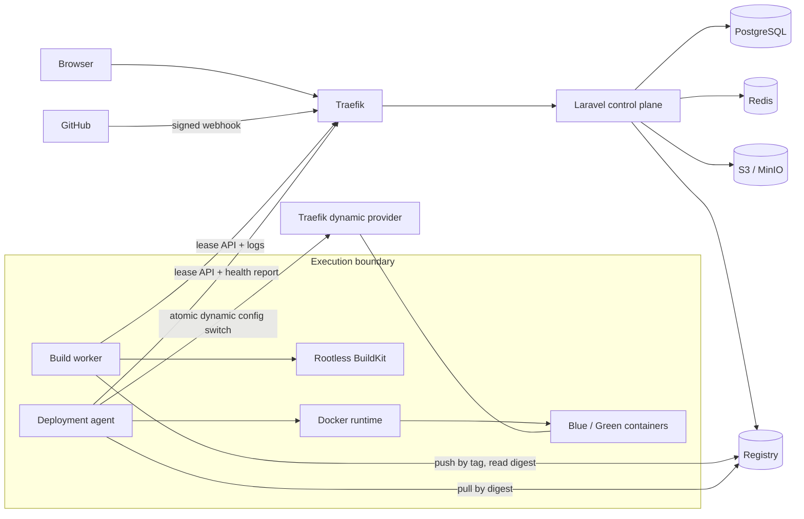
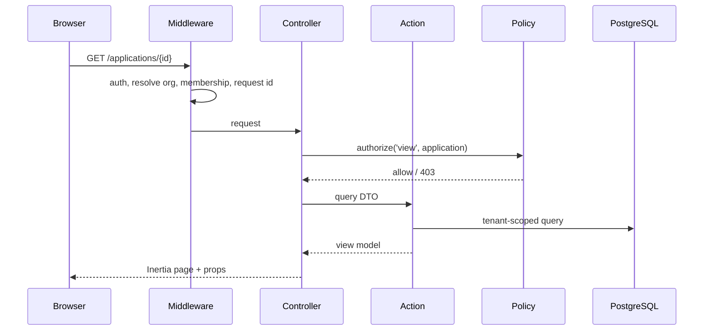
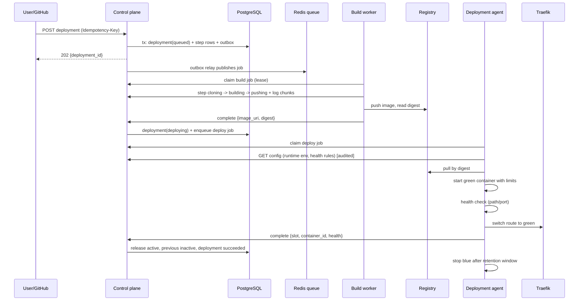

# Architecture

**Style:** modular monolith control plane + isolated execution workers.
**Contract:** this document, not `blueprint.md`, defines boundaries. Decisions: `docs/adr/`.

---

## 1. Why this shape

The control plane owns business logic, authorization, configuration, and lifecycle state. Execution is the only thing
that touches repository code and the container runtime, and it runs outside the Laravel process. This keeps a
compromised build from reaching the database or user sessions, and keeps a web request from ever waiting on a build.

We deliberately do **not** split identity, applications, or deployments into services (ADR-002). Extraction is allowed
only when an operational constraint (independent scaling, failure isolation) justifies its cost.

---

## 2. Component view



Trust boundaries:

| Boundary | Rule |
|---|---|
| Browser → control plane | session auth, CSRF, policies, rate limits |
| GitHub → control plane | HMAC signature on raw body, delivery dedupe, size limit |
| Control plane → execution | short-lived HMAC-signed requests; workers never call each other |
| Execution → control plane | only the internal contract in `docs/WORKER-CONTRACTS.md` |
| Execution → host runtime | narrow scope, no arbitrary command endpoint, no user input as shell |
| Control plane → DB/Redis/S3/registry | least-privilege credentials via env/secret store |

---

## 3. Module map

```text
app/
├── Domain/
│   ├── Identity/          User, session policy hooks, password reset
│   ├── Organizations/     Organization, Membership, Invitation, roles
│   ├── Integrations/      GithubInstallation, Repository, webhook event model
│   ├── Applications/      Application, build configuration value objects
│   ├── Environments/      Environment, EnvironmentVariable
│   ├── Deployments/       Deployment, DeploymentStep, DeploymentEvent, Release,
│   │                      DeploymentStateMachine, failure codes
│   ├── Builds/            WorkerJob (build), build payload value objects
│   ├── Workers/           Worker, WorkerCredential, lease policy
│   ├── Secrets/           encryption, redaction services (interfaces)
│   ├── Observability/     structured logging context, metrics contracts
│   └── Audit/             AuditLog, AuditRecorder
├── Application/
│   ├── Actions/           one class per use case
│   ├── DTOs/              immutable input/output objects
│   ├── Services/          orchestration that spans actions (e.g. DeploymentOrchestrator)
│   └── Events/            domain events that feed the outbox
├── Infrastructure/
│   ├── GitHub/            GitHubAppClient, InstallationTokenProvider, WebhookVerifier
│   ├── Registry/          RegistryGateway (local registry, GHCR)
│   ├── Storage/           LogStore (S3), signed URL policy
│   ├── Execution/         JobLeaseRepository, WorkerAuthenticator, HmacSigner
│   └── Queue/             outbox relay, job routing
├── Http/
│   ├── Controllers/       Web (Inertia) + Internal (JSON)
│   ├── Middleware/        ResolveOrganization, EnsureRole, RequestId, VerifyWorkerSignature
│   └── Requests/          validation only
└── Jobs/                  control-plane queue jobs (not build/deploy execution)
```

### Dependency rule

`Http → Application → Domain`, and `Infrastructure` implements interfaces that `Application`/`Domain` declare.
`Domain` must not depend on `Http` or on concrete infrastructure. Cross-module access goes through a published
interface or an application service — never by reaching into another module's internals (e.g. no
`Application::query()` from the Deployments module).

Practical enforcement: PHPStan baseline must stay empty; a review that adds a cross-module `use` from `Domain` into
another module's namespace is rejected.

---

## 4. Request flow (dashboard)



`ResolveOrganization` binds the active organization into the container and starts a `TenantContext`. Models use a
`BelongsToOrganization` global scope that reads it. System contexts (webhook processing, queue jobs, workers) must set
`TenantContext::for($organizationId)` explicitly; `TenantContext::withoutScope()` is allowed only in migrations,
seeding, and the audit/ops commands — and every use is listed in `docs/SECURITY.md`.

If no tenant context is set on a request path, the query throws. Silent cross-tenant reads are treated as a bug.

---

## 5. Deployment flow (happy path)



Failure at any step: the control plane records `failed` with a code, keeps the active release, and the agent stops the
green container. No state is inferred from log text.

---

## 6. Background work

Three distinct execution types — do not mix them:

| Type | Runs in | Trigger | Storage of truth |
|---|---|---|---|
| Control-plane queue job | `queue:work` (Horizon) | outbox relay | `outbox_messages` + Redis payload |
| Build job | `workers/build-worker` | lease API | `worker_jobs` + `deployments` |
| Deploy job | `workers/deployment-agent` | lease API | `worker_jobs` + `deployments` |

Redis is never the only home of deployment state (ADR-004). Every transition is committed to PostgreSQL before the
next dispatch.

---

## 7. Data ownership

| Store | Owns | Never stores |
|---|---|---|
| PostgreSQL | orgs, users, config, deployments, releases, jobs, audit, outbox | raw log bodies, secrets in plaintext |
| Redis | queue, locks, leases cache, nonce cache, rate limits | authoritative deployment state |
| Object storage | log chunks, diagnostic bundles | credentials |
| Registry | images | application metadata |

---

## 8. Failure and recovery model

Ordering guarantees:

1. State change and outbox row commit atomically.
2. Job dispatch is at-least-once; every handler is idempotent by `deployment_id` + step.
3. Lease expiry is the only authority for "worker died". A reaper requeues if attempts remain, otherwise fails the
   deployment with `WORKER_LOST`.
4. The agent's `complete` callback is idempotent; replaying it cannot create a second release.
5. Traffic switch is the commit point for activation. If the switch succeeds but the callback fails, the agent retries
   with the same idempotency key and reports the observed route; the control plane reconciles from the agent's
   reported slot rather than assuming.

Compensation:

| Failure | Compensation |
|---|---|
| Build fails | mark failed; green container never created |
| Push fails | retry bounded; then fail; workspace destroyed |
| Container start fails | stop green, keep blue active |
| Health check fails | stop green, keep blue active, emit `HEALTH_CHECK_FAILED` |
| Traffic switch fails | attempt revert to blue, fail deployment |
| Callback lost after switch | agent retries; control plane reconciles route to green |
| Rollback fails | current active release untouched; emit `ROLLBACK_FAILED` |

---

## 9. Extension points (not built in v1)

- Additional registry: implement `RegistryGateway`.
- Additional Git provider: implement `SourceProvider`.
- Additional runtime: implement `ContainerRuntime` in the agent.
- Multi-host: workers already authenticate individually; add target selection to the deploy job payload.
- Custom domains: Traefik router per environment host (FR-021).

Each requires an ADR and a doc update before code.

---

## 10. Deployment topology (v1)

Single Docker host:

```text
host
├── traefik            public :80/:443, file provider (dynamic config per environment)
├── control-plane      app + queue + horizon (no docker socket)
├── postgres, redis, minio, registry
├── build-worker       rootless BuildKit, egress-limited
└── deployment-agent   docker access restricted to deployflow-* resources
```

Multi-host is a documented extension, not a v1 feature (ADR-021).
