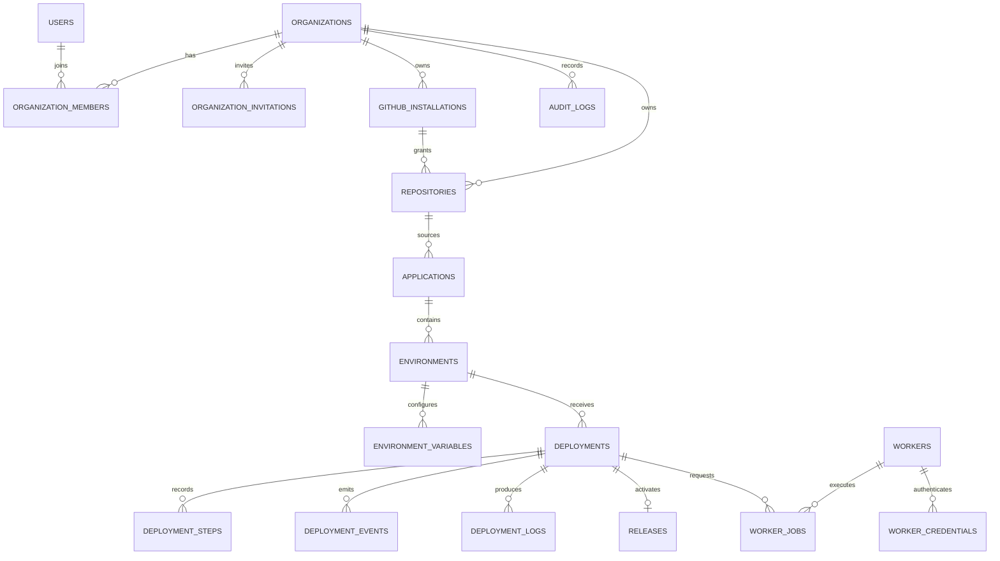

# Data Model

**Source of truth for schema.** Supersedes `blueprint.md` §3 where they differ.
Migrations are the final authority; this document must be updated in the same PR (I-14).

---

## 1. Conventions

| Rule | Detail |
|---|---|
| Primary keys | `uuid` using UUIDv7 (`Str::uuid7()`), generated in PHP so records are valid before insert |
| Timestamps | `timestamptz`, always UTC; `created_at` / `updated_at` unless append-only |
| Naming | plural snake_case tables, singular FK `*_id`, booleans `is_*`/past participle |
| Enums | `varchar(32)` + PHP backed enum cast; **no** PostgreSQL enum types (hard to migrate) |
| Money/JSON | JSONB only for genuinely open metadata (`metadata`, `capabilities`, `build_configuration`) |
| Deletion | Soft delete only where the product archives (`organizations`, `applications`); deployments/releases are never deleted |
| Secrets | `encrypted_*` columns use Laravel `encrypted` cast; key lives outside the DB |
| Tenant columns | Every tenant table carries `organization_id`, including denormalized child tables |
| Composite FKs | `(organization_id, parent_id)` → `parent(organization_id, id)` so a child cannot point at another tenant's parent |
| Migrations | `create_*_table`, `add_*_to_*`; expand/contract for live changes; every migration reversible |

`organization_id` is never trusted from request input; it is taken from the resolved tenant context.

---

## 2. Entity relationships

---

## 3. Framework tables

Laravel-owned, created by the framework migrations:

- `users` — uuid pk, name, email unique, password, email_verified_at, remember_token, timestamps.
- `password_reset_tokens` — email pk, token (hashed), created_at.
- `failed_jobs` — control-plane queue failures. Required even with Redis queues.
- `job_batches` — optional; include if batches are used.

Not used: `sessions` (driver = `redis`), `cache` (driver = `redis`), `jobs` (queue = `redis`).

---

## 4. Tenant and identity

### organizations

| Column | Type | Constraints |
|---|---|---|
| id | uuid | pk |
| name | varchar(120) | not null |
| slug | varchar(80) | not null, unique, `^[a-z0-9-]+$` |
| owner_id | uuid | not null, FK users, `on delete restrict` |
| settings | jsonb | not null default `{}` |
| created_at / updated_at | timestamptz | |
| deleted_at | timestamptz | nullable |

Rules: `owner_id` is canonical. The owner must also have an `organization_members` row with role `owner`; transfer is a
single transaction updating both. Deleting an organization is soft-delete + archive cascade (post-v1).

### organization_members

| Column | Type | Constraints |
|---|---|---|
| id | uuid | pk |
| organization_id | uuid | not null FK organizations cascade |
| user_id | uuid | not null FK users cascade |
| role | varchar(16) | not null, enum `owner\|admin\|developer\|viewer` |
| created_at / updated_at | timestamptz | |

- `unique (organization_id, user_id)`
- `index (user_id)`
- Partial unique `unique (organization_id) where role = 'owner'` — exactly one owner per organization.

### organization_invitations

| Column | Type | Constraints |
|---|---|---|
| id | uuid | pk |
| organization_id | uuid | not null FK cascade |
| email | varchar(254) | not null, normalized lowercase |
| role | varchar(16) | not null, enum, cannot be `owner` |
| token_hash | varchar(64) | not null, unique (sha256 of the emailed token) |
| invited_by | uuid | not null FK users restrict |
| expires_at | timestamptz | not null |
| accepted_at | timestamptz | nullable |
| created_at / updated_at | timestamptz | |

- Partial unique `(organization_id, lower(email)) where accepted_at is null`
- Invitations expire after 7 days. Accepting requires a verified user with the matching email.

---

## 5. GitHub integration

### github_installations

| Column | Type | Constraints |
|---|---|---|
| id | uuid | pk |
| organization_id | uuid | not null FK organizations cascade |
| installation_id | bigint | not null, unique (GitHub's ID) |
| account_login | varchar(120) | not null |
| account_type | varchar(16) | not null (`Organization\|User`) |
| status | varchar(16) | not null, enum `active\|suspended\|revoked` |
| suspended_at | timestamptz | nullable |
| revoked_at | timestamptz | nullable |
| created_at / updated_at | timestamptz | |

The GitHub App private key and webhook secret are **not** stored here; they come from
`config('services.github.*')` / secret storage (I-4).

### repositories

| Column | Type | Constraints |
|---|---|---|
| id | uuid | pk |
| organization_id | uuid | not null FK organizations cascade |
| github_installation_id | uuid | not null FK github_installations cascade |
| external_id | bigint | not null (GitHub repo ID) |
| full_name | varchar(255) | not null |
| default_branch | varchar(255) | not null |
| is_private | boolean | not null default true |
| is_archived | boolean | not null default false |
| created_at / updated_at | timestamptz | |

- `unique (github_installation_id, external_id)`
- `index (organization_id, full_name)`
- Composite FK `(organization_id, github_installation_id)` → `github_installations(organization_id, id)`; requires
  `unique (organization_id, id)` on the parent.

### github_webhook_events

| Column | Type | Constraints |
|---|---|---|
| id | uuid | pk |
| delivery_id | varchar(64) | not null, **unique** |
| event_type | varchar(64) | not null |
| action | varchar(64) | nullable |
| organization_id | uuid | nullable FK organizations null on delete |
| installation_external_id | bigint | nullable |
| repository_external_id | bigint | nullable |
| payload | jsonb | not null (validated, size-capped) |
| payload_sha256 | char(64) | not null |
| status | varchar(16) | not null, enum `received\|processed\|ignored\|failed` |
| error | text | nullable (sanitized) |
| received_at | timestamptz | not null |
| processed_at | timestamptz | nullable |

- `index (status, received_at)`
- `index (organization_id, received_at desc)`
- Accepted before processing; raw body is never logged.

---

## 6. Applications and configuration

### applications

| Column | Type | Constraints |
|---|---|---|
| id | uuid | pk |
| organization_id | uuid | not null FK organizations cascade |
| repository_id | uuid | not null FK repositories restrict |
| name | varchar(120) | not null |
| slug | varchar(80) | not null, `^[a-z0-9-]+$` |
| description | text | nullable |
| framework | varchar(40) | nullable, informational only |
| build_configuration | jsonb | not null default `{}` (schema in `WORKER-CONTRACTS.md` §3) |
| health_check_path | varchar(255) | not null default `/health` |
| health_check_port | integer | nullable (defaults to container port) |
| created_by | uuid | not null FK users restrict |
| created_at / updated_at | timestamptz | |
| archived_at | timestamptz | nullable |

- `unique (organization_id, slug)`, `unique (organization_id, id)` (composite FK target)
- `index (repository_id)`
- Composite FK `(organization_id, repository_id)` → `repositories(organization_id, id)`

### environments

| Column | Type | Constraints |
|---|---|---|
| id | uuid | pk |
| organization_id | uuid | not null (denormalized, I-2) |
| application_id | uuid | not null FK applications cascade |
| name | varchar(40) | not null, `^[a-z][a-z0-9-]*$` |
| branch | varchar(255) | not null |
| is_auto_deploy | boolean | not null default false |
| status | varchar(16) | not null, enum `active\|disabled` |
| deployment_strategy | varchar(16) | not null default `blue_green` |
| health_check_path | varchar(255) | nullable (overrides application) |
| health_check_port | integer | nullable |
| public_host | varchar(255) | nullable, unique (routing authority) |
| created_at / updated_at | timestamptz | |

- `unique (application_id, name)`, `unique (organization_id, id)`
- Composite FK `(organization_id, application_id)` → `applications(organization_id, id)`
- `public_host` format validated (lowercase DNS label under the configured base domain).

### environment_variables

| Column | Type | Constraints |
|---|---|---|
| id | uuid | pk |
| organization_id | uuid | not null |
| environment_id | uuid | not null FK environments cascade |
| key | varchar(255) | not null, `^[A-Z_][A-Z0-9_]*$` |
| encrypted_value | text | not null (Laravel encrypted cast) |
| is_secret | boolean | not null default true |
| created_at / updated_at | timestamptz | |

- `unique (environment_id, key)`
- Composite FK `(organization_id, environment_id)` → `environments(organization_id, id)`
- Reserved keys rejected: `PATH`, `PORT`, `HOME`, `HOSTNAME`, `LD_*`, `DYLD_*`.
- Values are never selected into API resources; `is_secret` controls masking in the UI list.

---

## 7. Deployment lifecycle

### deployments

| Column | Type | Constraints |
|---|---|---|
| id | uuid | pk |
| organization_id | uuid | not null |
| application_id | uuid | not null |
| environment_id | uuid | not null |
| triggered_by | uuid | nullable FK users null on delete |
| trigger_type | varchar(16) | not null, enum `manual\|webhook\|rollback\|retry` |
| source_event_id | uuid | nullable FK github_webhook_events null on delete |
| rollback_of_deployment_id | uuid | nullable FK deployments null on delete |
| commit_sha | char(40) | not null, `^[0-9a-f]{40}$` |
| branch | varchar(255) | not null |
| image_uri | varchar(512) | nullable (must start with configured registry host) |
| image_digest | varchar(71) | nullable, `^sha256:[0-9a-f]{64}$` |
| status | varchar(24) | not null, enum in `STATE-MACHINES.md` |
| failure_code | varchar(48) | nullable (enum from `ERROR-CODES.md`) |
| failure_reason | text | nullable, sanitized human message |
| idempotency_key | varchar(128) | nullable |
| cancellation_requested_at | timestamptz | nullable |
| started_at / finished_at | timestamptz | nullable |
| created_at / updated_at | timestamptz | |

- `unique (environment_id, idempotency_key) where idempotency_key is not null`
- `unique (environment_id, id)` (composite FK target)
- `index (application_id, created_at desc)`
- `index (environment_id, status)`
- `index (status, created_at)`
- `index (rollback_of_deployment_id)`
- Composite FKs: `(organization_id, application_id)` and `(organization_id, environment_id)`.
- Check: `rollback_of_deployment_id is null or trigger_type = 'rollback'`
- Check: `finished_at is null or finished_at >= created_at`

Immutability: once a deployment reaches `succeeded`, `failed`, or `cancelled`, only `failure_code`,
`failure_reason`, `finished_at`, and `updated_at` may change (and only if not already set). `commit_sha`,
`image_digest`, `environment_id`, and `trigger_type` never change.

### deployment_steps

| Column | Type | Constraints |
|---|---|---|
| id | uuid | pk |
| deployment_id | uuid | not null FK deployments cascade |
| name | varchar(24) | not null, enum `clone\|build\|push\|pull\|deploy\|health_check\|activate\|rollback` |
| attempt | smallint | not null default 1 |
| status | varchar(16) | not null, enum `queued\|running\|succeeded\|failed\|skipped` |
| started_at / finished_at | timestamptz | nullable |
| error_code | varchar(48) | nullable |
| metadata | jsonb | not null default `{}` (no secrets) |

- `unique (deployment_id, name, attempt)`
- `index (deployment_id, status)`
- Step sets are fixed per `trigger_type`; see `STATE-MACHINES.md` §4.

### deployment_events

Append-only UI timeline and SSE source.

| Column | Type | Constraints |
|---|---|---|
| id | uuid | pk |
| deployment_id | uuid | not null FK deployments cascade |
| sequence | bigint | not null |
| type | varchar(48) | not null (e.g. `status_changed`, `step_started`, `gate_blocked`) |
| message | text | not null |
| metadata | jsonb | not null default `{}` |
| created_at | timestamptz | not null |

- `unique (deployment_id, sequence)`
- `index (deployment_id, created_at)`

### deployment_logs

Chunk index only. Content lives in object storage.

| Column | Type | Constraints |
|---|---|---|
| id | uuid | pk |
| deployment_id | uuid | not null FK deployments cascade |
| step_id | uuid | nullable FK deployment_steps null on delete |
| sequence | bigint | not null (monotonic per deployment) |
| storage_key | varchar(512) | not null, unique |
| size_bytes | bigint | not null |
| created_at | timestamptz | not null |

- `unique (deployment_id, sequence)`
- `index (deployment_id, step_id, sequence)`
- Append-only; retention job deletes objects + rows after the configured window (default 30 days).

### releases

| Column | Type | Constraints |
|---|---|---|
| id | uuid | pk |
| organization_id | uuid | not null |
| deployment_id | uuid | not null, **unique** FK deployments restrict |
| environment_id | uuid | not null |
| image_uri | varchar(512) | not null |
| image_digest | varchar(71) | not null, `^sha256:[0-9a-f]{64}$` |
| slot | varchar(8) | not null, enum `blue\|green` |
| status | varchar(16) | not null, enum `active\|inactive` |
| activated_at / deactivated_at | timestamptz | nullable |
| created_at / updated_at | timestamptz | |

- Partial unique `unique (environment_id) where status = 'active'` — exactly one active release per environment.
- `index (environment_id, created_at desc)`
- Composite FKs to deployments and environments with `organization_id`.

Activation is a single transaction: previous active → `inactive` (`deactivated_at = now()`), new → `active`
(`activated_at = now()`).

---

## 8. Execution

### workers

| Column | Type | Constraints |
|---|---|---|
| id | uuid | pk |
| name | varchar(120) | not null, unique |
| type | varchar(8) | not null, enum `build\|deploy` |
| status | varchar(16) | not null, enum `online\|offline\|draining` |
| version | varchar(32) | not null |
| capabilities | jsonb | not null default `{}` (e.g. `{"buildkit":"rootless","platforms":["linux/amd64"]}`) |
| labels | jsonb | not null default `{}` |
| max_concurrency | smallint | not null default 1 |
| last_heartbeat_at | timestamptz | nullable |
| created_at / updated_at | timestamptz | |

- `index (type, status)`
- Offline when `last_heartbeat_at < now() - interval '60 seconds'` (reaper; not a stored transition).

### worker_credentials

| Column | Type | Constraints |
|---|---|---|
| id | uuid | pk |
| worker_id | uuid | not null FK workers cascade |
| prefix | char(12) | not null, unique (first 12 chars, for lookup/display) |
| secret_encrypted | text | not null, Laravel encrypted cast (needed to verify HMAC) |
| expires_at | timestamptz | nullable |
| revoked_at | timestamptz | nullable |
| last_used_at | timestamptz | nullable |
| created_at / updated_at | timestamptz | |

The raw secret is shown once at registration and never again. It is encrypted (not hashed) because HMAC verification
requires the original value — see `SECURITY.md` §Worker authentication.

### worker_jobs

| Column | Type | Constraints |
|---|---|---|
| id | uuid | pk |
| organization_id | uuid | not null |
| deployment_id | uuid | not null FK deployments cascade |
| worker_id | uuid | nullable FK workers null on delete |
| job_type | varchar(16) | not null, enum `build\|deploy\|rollback` |
| status | varchar(16) | not null, enum `queued\|leased\|running\|completed\|failed\|cancelled` |
| payload | jsonb | not null (must match contract; contains **no** runtime secrets) |
| attempts | smallint | not null default 0 |
| max_attempts | smallint | not null default 3 |
| available_at | timestamptz | not null default now() |
| lease_expires_at | timestamptz | nullable |
| lease_token | uuid | nullable |
| last_error_code | varchar(48) | nullable |
| created_at / updated_at | timestamptz | |

- Partial unique `unique (deployment_id, job_type) where status in ('leased','running')` — prevents double execution.
- `index (status, available_at)`
- `index (worker_id, status)`
- Composite FK `(organization_id, deployment_id)` → `deployments(organization_id, id)`.
- Claim uses `SELECT ... FOR UPDATE SKIP LOCKED` with `status = 'queued' and available_at <= now()` ordered by
  `created_at`, limited to worker capacity.

### outbox_messages

| Column | Type | Constraints |
|---|---|---|
| id | uuid | pk |
| aggregate_type | varchar(64) | not null |
| aggregate_id | uuid | not null |
| event_type | varchar(64) | not null |
| payload | jsonb | not null |
| status | varchar(16) | not null, enum `pending\|dispatched\|failed` |
| attempts | smallint | not null default 0 |
| available_at | timestamptz | not null default now() |
| dispatched_at | timestamptz | nullable |
| last_error | text | nullable |
| created_at / updated_at | timestamptz | |

- `index (status, available_at)`
- `index (aggregate_type, aggregate_id)`
- Written in the same transaction as the state change (I-7). Relay polls `pending` with `SKIP LOCKED`, dispatches, and
  marks `dispatched`; idempotent consumer key = `outbox id`.

---

## 9. Audit and notifications

### audit_logs

| Column | Type | Constraints |
|---|---|---|
| id | uuid | pk |
| organization_id | uuid | nullable FK organizations null on delete |
| actor_id | uuid | nullable FK users null on delete |
| actor_type | varchar(16) | not null, enum `user\|system\|worker` |
| action | varchar(64) | not null (e.g. `deployment.created`, `secret.updated`) |
| resource_type | varchar(64) | not null |
| resource_id | uuid | nullable |
| ip_address | inet | nullable |
| user_agent | varchar(255) | nullable |
| metadata | jsonb | not null default `{}` — sanitized, never secret values |
| created_at | timestamptz | not null |

- `index (organization_id, created_at desc)`
- `index (resource_type, resource_id)`
- Append-only. Writers use `AuditRecorder`; direct inserts are rejected in review.

### notifications

| Column | Type | Constraints |
|---|---|---|
| id | uuid | pk |
| organization_id | uuid | not null FK organizations cascade |
| user_id | uuid | nullable FK users cascade |
| type | varchar(64) | not null |
| data | jsonb | not null |
| read_at | timestamptz | nullable |
| created_at / updated_at | timestamptz | |

- `index (user_id, read_at, created_at desc)`
- Deduplicated per `(user_id, type, data->>'deployment_id')` for failure notifications.

---

## 10. Cross-cutting rules

1. Every tenant table has `organization_id`; every query is scoped (I-2).
2. Composite FKs prevent cross-tenant parent references at the database level.
3. Deployments reference a commit SHA and a digest; mutable branches are metadata only (I-5).
4. Deployment history is append-only. A retry or rollback creates a new deployment.
5. Exactly one active release per environment (partial unique index).
6. Exactly one live lease per `(deployment, job_type)` (partial unique index).
7. Webhook `delivery_id` is unique (I-11).
8. State change + outbox row share a transaction (I-7).
9. Secrets are encrypted at rest; values are excluded from every resource and log context (I-4).
10. Logs are chunked to object storage; PostgreSQL stores only the chunk index.
11. `updated_at` is not used as an ordering key for deployments; use `created_at`/`sequence`.
12. Deleting an environment with an active release is blocked until the release is deactivated by an explicit action.
