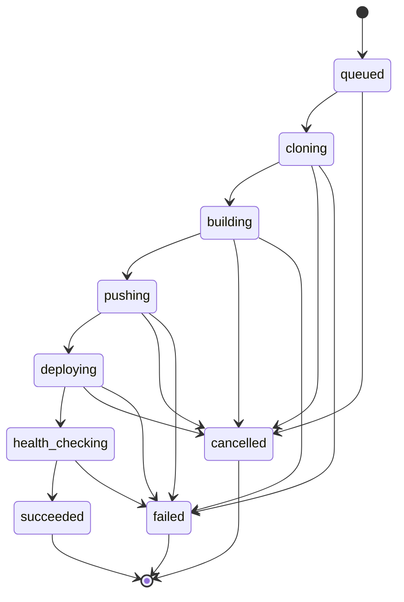
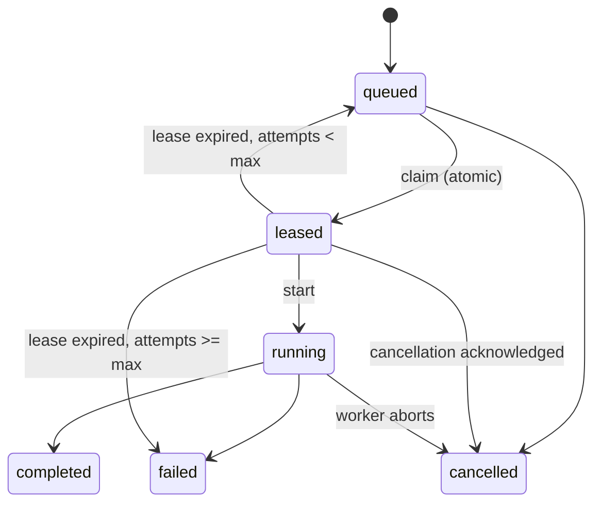

# State Machines

**Single source of truth for lifecycle.** `DeploymentStateMachine` is the only writer of `deployments.status`.
Rejected transitions return `409 STATE_CONFLICT` with `{from, to, code}`.

Every transition runs inside a transaction and writes a `deployment_events` row. Transition + outbox rows share the
same transaction (I-7).

---

## 1. Deployment states

`succeeded`, `failed`, `cancelled` are terminal. Rollback is **not** a state on an existing deployment; it is a new
deployment with `trigger_type=rollback` (ADR-014).

### Transition table

| From | To | Actor | Guard | Side effects |
|---|---|---|---|---|
| — | `queued` | user / webhook / rollback action | policy passes, env active, no active deployment for env, idempotency key free | insert deployment, steps (`queued`), outbox `deployment.queued`, audit |
| `queued` | `cloning` | build worker (start) | job `build` leased by this worker, lease valid | step `clone` → running, `started_at` |
| `cloning` | `building` | build worker (step report) | step `clone` succeeded | step `build` running |
| `building` | `pushing` | build worker | step `build` succeeded, image tag known | step `push` running |
| `pushing` | `deploying` | build worker (complete) | `image_digest` set, registry push verified, digest matches manifest | step `push` succeeded, persist digest, outbox `deployment.deploy_requested` |
| `deploying` | `health_checking` | deploy agent (step report) | container started, slot assigned, step `deploy` succeeded | step `health_check` running, release row `inactive` |
| `health_checking` | `succeeded` | deploy agent (complete) | health passed **and** traffic switched **and** release activated | step `activate` succeeded, release active, previous inactive, `finished_at`, audit, notification |
| `queued`…`deploying` | `cancelled` | user (cancel action) | no traffic switch yet | outbox `deployment.cancel_requested`, worker told to abort, steps → skipped |
| `cloning`…`health_checking` | `failed` | worker (fail) / reaper | `failure_code` provided | stop green container if created, steps → failed/skipped, `finished_at`, audit, notification |
| terminal | terminal | — | never | rejected |

Guards are enforced in code, not only by the DB check constraints:
- terminal states accept no status change; a repeated completion callback returns the current deployment unchanged (200),
  not an error.
- `succeeded` requires a non-null `image_digest` and `finished_at`.
- `failed` requires a non-null `failure_code`.
- A deployment cannot start if one is already active in the environment (`409 DEPLOYMENT_ALREADY_RUNNING`).

### Cancellation (ADR-022)

| Current state | Cancel result |
|---|---|
| `queued` | immediate → `cancelled`; job row `cancelled` |
| `cloning`, `building`, `pushing`, `deploying` | set `cancellation_requested_at`; job is signalled; worker stops and reports `CANCELLED`; control plane → `cancelled` |
| `health_checking` before traffic switch | same as above; green container destroyed |
| after traffic switch / `succeeded` | `409 CANNOT_CANCEL_AFTER_ACTIVATION`; use rollback |
| `failed`, `cancelled` | `409` no-op is not exposed; endpoint returns current state |

Cancellation must be idempotent and must never delete a deployment record.

---

## 2. Human-facing status mapping

The UI shows `status` plus a short label. No derived states in the view layer.

| Status | Label | Terminal |
|---|---|---|
| `queued` | Queued | no |
| `cloning` | Cloning repository | no |
| `building` | Building image | no |
| `pushing` | Pushing image | no |
| `deploying` | Starting container | no |
| `health_checking` | Checking health | no |
| `succeeded` | Deployed | yes |
| `failed` | Failed | yes |
| `cancelled` | Cancelled | yes |

---

## 3. Worker job states

| Rule | Detail |
|---|---|
| Lease duration | 90 s; heartbeat every 30 s |
| Claim | `FOR UPDATE SKIP LOCKED`, `available_at <= now()`, type matches worker, capacity respected |
| `attempts` | incremented on claim, not on start |
| Requeue backoff | `min(30 * 2^(attempts-1), 600)` seconds |
| Terminal guard | `complete`/`fail` require the current `lease_token`; stale tokens get `409 LEASE_LOST` |
| Cancellation | Worker checks `cancellation_requested_at` on every heartbeat and between steps |
| Max attempts | 3 for build, 2 for deploy/rollback |

A job row is never deleted; it is evidence.

---

## 4. Step sets

Every deployment gets its step rows at creation so the timeline is stable.

| `trigger_type` | Steps (in order) |
|---|---|
| `manual`, `webhook`, `retry` | `clone`, `build`, `push`, `pull`, `deploy`, `health_check`, `activate` |
| `rollback` | `pull`, `deploy`, `health_check`, `activate` |

Step transitions: `queued → running → succeeded | failed | skipped`. A step cannot start before the previous step is
`succeeded`. Retries create `attempt + 1` rows; the previous attempt is left as-is.

Steps are reported by the worker through the internal contract; the control plane validates order and derives the
deployment status. Log text never drives state.

---

## 5. Release states

| From | To | Trigger | Notes |
|---|---|---|---|
| — | `inactive` | agent created the green container | one row per verified deployment |
| `inactive` | `active` | activation transaction | previous `active` → `inactive` in the same transaction |
| `active` | `inactive` | rollback activation or environment disable | never deleted |

Invariant: at most one `active` release per environment (DB partial unique index).

Rollback flow:

1. New deployment (`trigger_type=rollback`, `rollback_of_deployment_id` = the release's deployment).
2. Agent pulls the original digest (never rebuilds).
3. Start, health check, switch, activate.
4. The broken release becomes `inactive`; the restored one becomes `active`.

---

## 6. Environment states

| From | To | Guard |
|---|---|---|
| `active` | `disabled` | no deployment in a non-terminal state |
| `disabled` | `active` | application not archived |

A disabled environment rejects new deployments with `409 ENVIRONMENT_DISABLED`; an in-flight deployment is allowed to
finish (or be cancelled explicitly).

---

## 7. Worker states

| From | To | Trigger |
|---|---|---|
| — | `online` | registration |
| `online` | `offline` | no heartbeat for 60 s (reaper) |
| `offline` | `online` | heartbeat received |
| `online` | `draining` | operator action; no new claims |
| `draining` | `offline` | zero active leases |

Offline workers do not fail their jobs immediately: the lease must expire first, so a transient network blip does not
kill a healthy build.

---

## 8. Reconciliation (reaper)

Runs every 30 s as a control-plane queue job (`ReconcileExecutionState`). All operations are idempotent.

| Check | Action |
|---|---|
| Worker heartbeat stale | set `offline`; emit metric |
| Lease expired, attempts < max | job → `queued`, backoff, clear lease |
| Lease expired, attempts ≥ max | job → `failed`, deployment → `failed` with `WORKER_LOST` |
| Non-terminal deployment with no live job and no pending outbox | requeue once, then fail with `STUCK_DEPLOYMENT` |
| More than one active release in an environment | keep newest `activated_at`, deactivate others, alert critically |
| Deployment terminal but `finished_at` null | set `finished_at`, alert |
| `pending` outbox older than 5 min | retry, then `failed` + alert |
| Environment disabled with an active release | leave as-is, alert operations |

Reconciliation never guesses intent from logs; it only enforces documented invariants and records an
`deployment_events` row.

---

## 9. Idempotency rules

- Deployment creation: unique `(environment_id, idempotency_key)`. Replay returns the existing deployment with 202 and
  `Idempotency-Replayed: true`; a mismatched body hash returns `409 IDEMPOTENCY_KEY_REUSED`.
- Worker callbacks: identified by `(job_id, lease_token, event, step, attempt)`. Replay returns 200 with current state.
- Webhook processing: `delivery_id` unique; second delivery is accepted, stored as `ignored`, and never creates work.
- Outbox relay: consumer dedupes on outbox `id`.
- Health/activation completion: activation is a single transaction guarded by the partial unique index; a duplicate
  activation is a no-op returning the current release.
