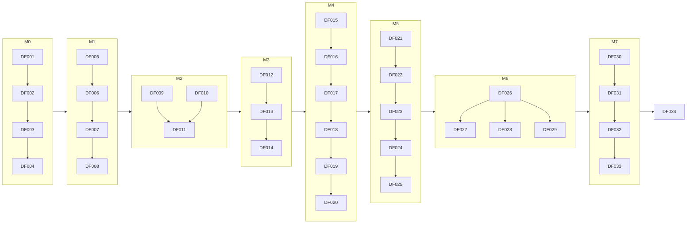

# Tasks

Executable breakdown of blueprint §12. Each task is independently reviewable and ends in a working, tested increment.

**Rules**
- Do not start a task whose `Depends` are not done.
- One branch per task: `feat/DF-0NN-slug`.
- The "Exit" column names the test/proof that closes the task; a task is not done without it.
- Update this file when scope changes (same PR).

Size: **S** ≤ 1 day, **M** 1–3 days, **L** 3–7 days. Estimates assume one focused developer with working context.

---

## 1. Dependency graph

---

## 2. Task index

| ID | M | Title | Depends | Size | Exit |
|---|---|---|---|---|---|
| DF-001 | M0 | Initialize Laravel 13 project | — | S | app boots, `/up` returns 200 |
| DF-002 | M0 | PostgreSQL, Redis, MinIO, registry in compose | DF-001 | S | migrations run, connections verified |
| DF-003 | M0 | Architecture docs + ADRs | DF-001 | S | docs reviewed, ADRs 001–022 present |
| DF-004 | M0 | CI pipeline | DF-001, DF-002 | S | PR shows green `ci.yml` |
| DF-005 | M1 | Authentication | DF-004 | M | auth feature tests (PRD §4) |
| DF-006 | M1 | Organizations + invitations + members | DF-005 | M | membership flow tests |
| DF-007 | M1 | RBAC policies | DF-006 | M | `AuthorizationMatrixTest` |
| DF-008 | M1 | Tenant isolation tests | DF-007 | S | `TenantIsolationTest` (SEC-01…03,19) |
| DF-009 | M2 | GitHub App install + repository sync | DF-008 | M | callback + sync tests |
| DF-010 | M2 | Webhook endpoint + dedupe | DF-009 | M | SEC-05…07 |
| DF-011 | M2 | Repository management UI/actions | DF-009, DF-010 | M | repo list/selection tests |
| DF-012 | M3 | Application CRUD | DF-011 | M | app tests + archive rules |
| DF-013 | M3 | Environment CRUD | DF-012 | M | env tests + branch config |
| DF-014 | M3 | Encrypted environment variables | DF-013 | M | SEC-13,14; `RedactionTest` |
| DF-015 | M4 | Worker contract + schemas | DF-014 | S | contract tests wired |
| DF-016 | M4 | Worker registration + heartbeat | DF-015 | M | register/heartbeat/offline tests |
| DF-017 | M4 | Job leasing + reaper | DF-016 | M | lease tests, SEC-10/12 |
| DF-018 | M4 | Git checkout + isolated build | DF-017 | L | FT-01…05; digest reported |
| DF-019 | M4 | Registry push + digest capture | DF-018 | M | FT-06/07; digest stored |
| DF-020 | M4 | Build log capture + redaction | DF-019 | M | SEC-15; logs in S3 |
| DF-021 | M5 | Deployment state machine | DF-020 | M | `DeploymentStateMachineTest` |
| DF-022 | M5 | Deployment agent auth | DF-021 | M | SEC-11/12 |
| DF-023 | M5 | Container deployment | DF-022 | L | FT-08; digest pull only |
| DF-024 | M5 | Health check + gate | DF-023 | M | FT-09; `HealthGateTest` |
| DF-025 | M5 | Blue-green switch + retention | DF-024 | L | FT-10/12; I-9/I-10 |
| DF-026 | M6 | Deployment history + timeline | DF-025 | M | history tests, tenant scoping |
| DF-027 | M6 | Log viewer (polling, later SSE) | DF-026 | M | SEC-13; pagination tests |
| DF-028 | M6 | Rollback | DF-026 | M | FT-16/17; digest reuse |
| DF-029 | M6 | In-app failure notifications | DF-026 | S | dedupe + read tests |
| DF-030 | M7 | End-to-end idempotency | DF-029 | M | SEC-08/09, FT-13/19/20 |
| DF-031 | M7 | Failure-injection suite | DF-030 | L | FT-01…20 automated |
| DF-032 | M7 | Observability (logs, metrics, alerts) | DF-030 | M | dashboards + metric assertions |
| DF-033 | M7 | Security review | DF-031, DF-032 | L | SEC-01…20 all green |
| DF-034 | M8 | Release + documentation | DF-033 | M | acceptance script passes |

---

## 3. Detailed tasks

### M0 — Foundation

**DF-001 — Initialize Laravel 13 project**
- `laravel/laravel ^13`, PHP 8.4, strict types, app skeleton.
- `git init` already done; keep `main` protected once the remote is live.
- `.env.example` with every key from `CONFIGURATION.md`; no real values.
- `/up` health route; `/healthz` for infra (DB + Redis ping, no secrets).
- `make setup/dev/test/lint/analyse/check` targets; `README` quickstart.
- Exit: `make setup && make check` green on a clean clone.

**DF-002 — Infrastructure compose**
- `docker-compose.yml` services: `postgres:17`, `redis:7`, `minio`, `registry:2`, `traefik:3`.
- App + queue + horizon profiles; no Docker socket in any app service.
- DB roles: app, migrate, readonly. Volumes + healthchecks.
- Exit: `docker compose config` valid; migrations run; `make dev` boots all dependencies.

**DF-003 — Architecture and ADRs**
- Commit `docs/` (this set) and ADRs 001–022.
- ADR template; every ADR has Context/Problem/Decision/Alternatives/Consequences/Security.
- Exit: docs link-checked; no unresolved "TBD" in contracts.

**DF-004 — CI**
- `.github/workflows/ci.yml`: composer validate, pint, phpstan, pest (with postgres+redis services), frontend build, `docker compose config`.
- `security.yml`: composer audit, npm audit, secret scan, Trivy fs.
- Pin actions by SHA before public release.
- Exit: PR shows required checks; branch protection documented.

### M1 — Identity and tenancy

**DF-005 — Authentication**
- Laravel session auth, verification, reset, profile; rate limits from `API.md` §6.
- Exit: `tests/Feature/Auth/*`.

**DF-006 — Organizations**
- Create/update/soft-delete, slug rules, owner invariant, invitations (expiry, token hash, email match), member role changes, owner transfer.
- Exit: `tests/Feature/Organizations/*`, exactly-one-owner test.

**DF-007 — RBAC**
- Policies for every model; `RolePermission` enum/truth table; middleware `ResolveOrganization`, `EnsureRole`.
- Exit: `AuthorizationMatrixTest` covers role × action twice (allow + deny).

**DF-008 — Tenant isolation**
- Global scope + `TenantContext`; route binding scoped; cross-tenant tests for applications, environments, deployments, variables, logs, invitations.
- Exit: SEC-01…03, SEC-19.

### M2 — GitHub

**DF-009 — GitHub App**
- `GitHubAppClient` interface + real adapter; JWT → installation token cache; callback `state` validation; installation + repository sync.
- Permissions: contents read, metadata read, packages write (if GHCR push via installation token), webhooks.
- Exit: valid/invalid state tests; token never returned to the browser.

**DF-010 — Webhooks**
- Raw-body HMAC verification, 2 MiB cap, delivery dedupe, persist-then-ack, async processing, installation/repo validation.
- Exit: SEC-05…07, `WebhookDeduplicationTest` (duplicate → one row, one deployment).

**DF-011 — Repositories**
- List accessible repos, register/archive, sync metadata, revoked installation handling.
- Exit: repo tests + `REPOSITORY_UNAVAILABLE` on deploy.

### M3 — Applications

**DF-012 — Applications**
- CRUD, slug uniqueness per org, archive/restore, build config validation (`WORKER-CONTRACTS.md` §5), health path validation.
- Exit: app feature tests; archive blocks deploy (`APPLICATION_ARCHIVED`).

**DF-013 — Environments**
- CRUD, branch, auto-deploy, strategy fixed `blue_green`, `public_host` allocation/validation, disabled behavior.
- Exit: env tests; duplicate name rejected; disabled env returns `ENVIRONMENT_DISABLED`.

**DF-014 — Variables**
- Encrypted cast, write-only API, reserved key rejection, audit on write (keys only), UI masking.
- Exit: SEC-13/14; value absent from response/log/audit.

### M4 — Build engine

**DF-015 — Contract**
- JSON Schemas for build/deploy/rollback, step report, logs, complete/fail; fixtures; contract test harness.
- Exit: schema validation runs in CI for both sides (worker stub may be used).

**DF-016 — Workers**
- Registration (bootstrap token, secret once), HMAC middleware, heartbeat, offline detection, capabilities/labels.
- Exit: registration/heartbeat/offline tests; replay rejected.

**DF-017 — Leasing**
- `FOR UPDATE SKIP LOCKED` claim, lease token, renewal, reaper, backoff, partial unique index.
- Exit: SEC-10/12; FT-11 applied to build jobs.

**DF-018 — Build (split into 5 PRs)**
- 018a: workspace lifecycle + safe clone at commit SHA (no shell interpolation, timeout, cleanup).
- 018b: rootless BuildKit runner + image build with limits.
- 018c: build args allowlist + Dockerfile path/context validation + `.dockerignore` handling.
- 018d: timeout/cancel/process-group kill + workspace sweep.
- 018e: step reporting + log streaming to the control plane.
- Exit: FT-01…05; workspace removed in all paths.

**DF-019 — Registry**
- `RegistryGateway` (local registry, GHCR), push by tag, read digest from registry, allowlist, bounded retries.
- Exit: FT-06/07; digest stored and validated.

**DF-020 — Logs**
- Chunk upload, sequence/idempotency, S3 write, index row, double redaction, retention job.
- Exit: SEC-15; log retrieval by cursor; oversized chunk rejected.

### M5 — Deployment engine

**DF-021 — State machine**
- All transitions from `STATE-MACHINES.md`; guards; event rows; outbox writes; terminal immutability.
- Exit: exhaustive transition tests; illegal transitions return 409.

**DF-022 — Agent auth**
- Same HMAC scheme, deploy-scoped credentials, lease ownership, config endpoint audit.
- Exit: SEC-11/12; config access with no lease denied.

**DF-023 — Container deployment (split into 4 PRs)**
- 023a: pull by digest only + registry allowlist.
- 023b: container create with limits/caps/user/network; env file on tmpfs.
- 023c: failure cleanup + idempotent reporting.
- 023d: runtime adapter fakes for tests.
- Exit: FT-08; no tag pull path exists.

**DF-024 — Health gate**
- Path/port validation, retries/timeouts/grace, success status set, failure blocks activation.
- Exit: FT-09; SEC-16 (path injection rejected).

**DF-025 — Blue-green (split into 3 PRs)**
- 025a: slot allocation, naming/labels/network contract.
- 025b: Traefik file-provider render + atomic switch + route verification + revert.
- 025c: retention/reaper for the previous slot; activation transaction with one-active-release index.
- Exit: FT-10/12; I-9/I-10 proven; rollback path available.

### M6 — Visibility and recovery

**DF-026 — History**
- Paginated list, detail with steps/timeline, filters (status, env), tenant scoping.
- Exit: history tests; no N+1 (assert query count).

**DF-027 — Log viewer**
- Cursor pagination, signed URLs, step filter, follow mode; SSE in a later PR.
- Exit: SEC-13; pagination + tenant denial.

**DF-028 — Rollback**
- Target selection, permission, new deployment record, digest reuse, health gate, audit.
- Exit: FT-16/17; no rebuild occurs.

**DF-029 — Notifications**
- In-app failure notifications, dedupe per deployment, read state.
- Exit: one notification per failed deployment; delivery failure recorded.

### M7 — Hardening

**DF-030 — Idempotency**
- Deployment keys (scope + body hash), webhook dedupe, outbox consumer dedupe, worker callback replay, concurrency tests.
- Exit: SEC-08/09, FT-13/19/20.

**DF-031 — Failure injection**
- Harness + all FT-01…20 automated or scripted with reproducible evidence.
- Exit: every case has a passing automated test or a documented manual script with output.

**DF-032 — Observability**
- Structured JSON logs with correlation fields; metrics for queue depth, deployment duration/success, worker heartbeat age, registry failures; alerts from `OPERATIONS.md`.
- Exit: metric assertions in tests; dashboard screenshots in the PR.

**DF-033 — Security review**
- SEC-01…20 green; compose surface assertion (no socket); secret scan clean; Trivy policy; dependency review; build isolation limitations documented.
- Exit: review checklist signed in the PR; ADRs updated with any changes.

**DF-034 — Release**
- Staging + prod deploy of the control plane, worker images, smoke tests, docs, demo repo, release notes, screenshots.
- Exit: PRD §10 acceptance script executed by someone other than the author.

---

## 4. Not in v1 (do not implement without an ADR)

DF-035+ candidates: buildpacks, custom domains/TLS, metrics dashboards per app, multi-host agents, public API tokens, SSO,
2FA, billing, multi-region, PR previews, scheduled deploys, canary strategies.
